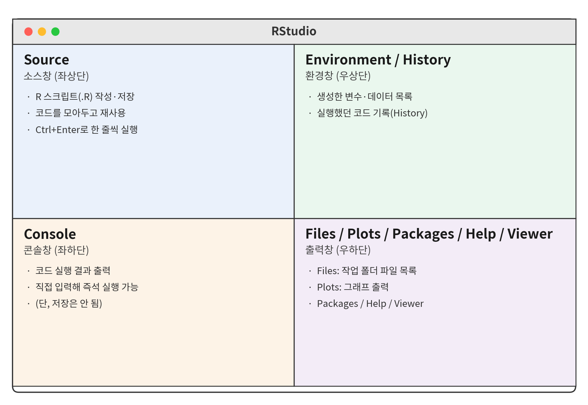
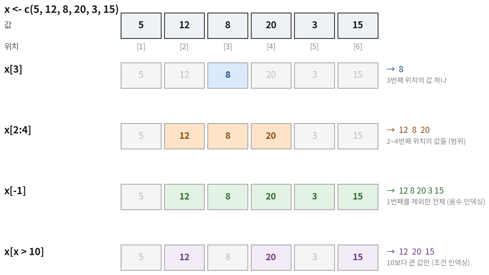

```{r}
#| include: false
source("_common.R")
```

::: {.doc}
::: {.session-meta}
<span>내용: RStudio 사용법, 자료형(문자형·숫자형·논리형), 자료구조(벡터·리스트·데이터프레임)</span>
<span>[슬라이드로 보기](d1-01-r-basics-slides.html)</span>
:::
:::

## 오늘 하루 흐름

| 시간 | 세션 | 내용 |
|---|---|---|
| 10:00–11:00 | **R 기초** | 자료형, 벡터 · 리스트 · 데이터프레임 |
| 11:00–12:00 | 데이터프레임 다루기 I | 주요 함수, 인덱싱 · 슬라이싱 |
| 13:00–15:00 | 데이터프레임 다루기 II | dplyr — select · filter · mutate · arrange |
| 15:00–17:00 | 데이터프레임 다루기 III | group_by · summarize, `_join` 결합 |

::: {.fragment}
::: {.box}
오전에는 R 자체의 문법(base R)을, 오후에는 dplyr 패키지로 같은 작업을 더 짧고 읽기 쉽게 하는 방법을 다룸. 실습 데이터는 국민체력100 체력측정 자료와 비슷한 구조로 만든 가상 데이터임.
:::
:::

::: {.notes}
- 자기소개, 오늘 일정 안내
- 오전 = base R, 오후 = dplyr 라는 큰 흐름을 먼저 말해두기
:::

# RStudio 시작하기 {background-color="#1f3a5f"}

R을 쓰는 작업 환경 익히기

## R과 RStudio

:::: {.columns}
::: {.column width="50%"}
**R**

- 통계 계산과 그래픽을 위한 프로그래밍 언어 (엔진)
- 무료, 오픈소스
- 2만 개 이상의 패키지로 기능 확장
:::

::: {.column width="50%"}
**RStudio**

- R을 편하게 쓰기 위한 통합개발환경(IDE)
- 코드 작성 · 실행 · 결과 확인을 한 화면에서
- R이 먼저 설치돼 있어야 실행됨
:::
::::

::: {.fragment}
설치 순서: **R 설치 → RStudio 설치**
:::

::: {.doc}
자동차에 비유하면 R은 엔진이고 RStudio는 계기판과 핸들이 달린 운전석임. RStudio는 단독으로 계산하지 않고, 내부적으로 R을 불러서 코드를 실행함.
:::

## RStudio 화면 구성

:::: {.columns}
::: {.column width="55%"}

:::

::: {.column width="45%" .small}
| 창 | 하는 일 |
|---|---|
| Source (좌상) | 스크립트(.R) 작성 · 저장 |
| Console (좌하) | 코드 실행, 결과 출력 |
| Environment (우상) | 만든 객체(변수 · 데이터) 목록 |
| Files / Plots / Help (우하) | 파일, 그래프, 도움말 |
:::
::::

::: {.doc}
Console에 직접 입력해도 실행은 되지만 기록이 남지 않음. 실습 코드는 항상 Source 창의 스크립트에 작성하고 저장하는 습관을 들이는 것이 좋음.
:::

## 프로젝트 만들고 스크립트 열기

::: {.incremental}
1. File → New Project → New Directory → New Project → 폴더 이름 입력
2. File → New File → R Script (단축키 `Ctrl + Shift + N`)
3. 코드 작성 후 **한 줄 실행**: `Ctrl + Enter` (Mac: `Cmd + Enter`)
4. 저장: `Ctrl + S` → `day1.R`
:::

::: {.fragment}
::: {.callout-tip title="프로젝트(.Rproj)를 쓰면"}
프로젝트 폴더가 자동으로 작업 디렉토리(working directory)가 되어서, 파일을 불러올 때 긴 경로를 쓰지 않아도 됨.
:::
:::

::: {.doc}
| 단축키 (Windows / Mac) | 기능 |
|---|---|
| `Ctrl + Enter` / `Cmd + Enter` | 현재 줄(또는 선택 영역) 실행 |
| `Ctrl + Shift + Enter` / `Cmd + Shift + Enter` | 스크립트 전체 실행 |
| `Alt + -` / `Option + -` | 할당 연산자 `<-` 입력 |
| `Ctrl + Shift + C` / `Cmd + Shift + C` | 선택한 줄 주석 처리 |
| `Ctrl + L` | 콘솔 화면 지우기 |
:::

## 첫 코드 실행

```{r}
#| code-line-numbers: "|1|2|3-4"
2 + 3
sqrt(16)       # 제곱근 함수, # 뒤는 주석(실행 안 됨)
x <- 10
x * 2
```

::: {.fragment}
- `<-` : **할당(assign)** — 오른쪽 값을 왼쪽 이름에 저장. 저장한 것을 **객체(object)**라고 함
- 객체를 만들면 Environment 창에 나타남
:::

::: {.notes}
- 세 번째 줄을 실행할 때 Environment 창을 같이 보여주기
- `=`도 되지만 R에서는 관례적으로 `<-` 사용
:::

## 객체 이름 규칙

| 가능 | 불가능 | 이유 |
|---|---|---|
| `grip`, `grip_2025` | `2025_grip` | 숫자로 시작할 수 없음 |
| `grip.left`, `gripLeft` | `grip left` | 공백 불가 |
| `Grip` 과 `grip` | | 대소문자를 구분 → 서로 다른 객체 |

::: {.fragment}
```{r}
#| error: true
grip <- 44.1
Grip
```
:::

::: {.doc}
이름은 영문 소문자와 밑줄(`_`)을 섞는 snake_case로 통일하면 읽기 쉬움. 한글 이름도 쓸 수는 있지만 인코딩 문제가 생길 수 있어 권장하지 않음.
:::

## 함수와 도움말

함수는 `함수이름(인자1, 인자2, ...)` 형태로 씀

```{r}
#| output-location: column-fragment
round(44.137)
round(44.137, digits = 1)
round(digits = 1, x = 44.137)
```

::: {.fragment}
- 인자 이름을 쓰면 순서를 바꿔도 됨
- 도움말: `?round` 또는 `help(round)` → Help 창에 설명 표시
:::

## 패키지 설치와 불러오기

```{r}
#| eval: false
install.packages("dplyr")   # 설치: 컴퓨터에 최초 1회
library(dplyr)              # 불러오기: R을 켤 때마다
```

::: {.fragment}
::: {.callout-note title="비유"}
`install.packages()`는 책을 사서 책장에 꽂는 것, `library()`는 오늘 읽을 책을 책상 위로 꺼내는 것.
:::
:::

::: {.doc}
`install.packages()`의 패키지 이름에는 따옴표가 필요하고, `library()`에는 따옴표가 없어도 됨. 설치한 패키지를 `library()` 없이 쓰면 `could not find function` 오류가 남.
:::

# 자료형 {background-color="#1f3a5f"}

문자형 · 숫자형 · 논리형

## 세 가지 기본 자료형

| 자료형 | 예시 | 확인 결과 `class()` | 설명 |
|---|---|---|---|
| 숫자형 | `44.1`, `175`, `-2.5` | `"numeric"` | 정수 · 소수 모두 포함 |
| 문자형 | `"1등급"`, `"44.1"` | `"character"` | 따옴표로 감싼 텍스트 |
| 논리형 | `TRUE`, `FALSE` | `"logical"` | 참 / 거짓 |

```{r}
#| output-location: column-fragment
class(44.1)
class("1등급")
class("44.1")
class(TRUE)
```

::: {.doc}
숫자라도 따옴표로 감싸면 문자형이 됨(`"44.1"`). 엑셀이나 CSV에서 불러온 측정값이 문자형으로 들어오는 경우가 많아서, 불러온 직후 자료형을 확인하는 것이 중요함.
:::

## 숫자형: 정수와 실수

```{r}
#| output-location: column-fragment
class(32)
class(32L)
typeof(32)
typeof(32L)
```

::: {.fragment}
- R의 숫자는 기본적으로 실수(`double`)로 저장됨
- 정수(`integer`)는 숫자 뒤에 `L`을 붙이거나 `1:10`처럼 만들 때 생김
- 분석할 때는 둘을 구분할 일이 거의 없음 → `class()`가 `numeric` 또는 `integer`면 숫자형으로 보면 됨
:::

## 산술 연산자

```{r}
#| output-location: column
weight <- 72.8
height <- 178.1
weight / (height / 100)^2   # BMI
48 %/% 10                   # 몫: 나이 48 → 40대
48 %% 10                    # 나머지
```

::: {.doc}
| 연산자 | 의미 | 예 | 결과 |
|---|---|---|---|
| `+` `-` `*` `/` | 사칙연산 | `7 / 2` | 3.5 |
| `^` | 거듭제곱 | `1.781 ^ 2` | 3.17 |
| `%/%` | 몫 | `48 %/% 10` | 4 |
| `%%` | 나머지 | `48 %% 10` | 8 |

BMI(체질량지수)는 체중(kg)을 키(m)의 제곱으로 나눈 값임. 키가 cm 단위이므로 100으로 나눠 m로 바꾼 뒤 제곱함. `%/%`로 나이를 10으로 나눈 몫을 구하면 연령대를 만들 수 있음.
:::

## 문자형 다루기

```{r}
#| output-location: column-fragment
name <- "김민준"
nchar(name)                  # 글자 수
paste("측정자", name)        # 공백으로 이어붙이기
paste0("A", 1:3)             # 공백 없이 이어붙이기
substr("2025-03-15", 1, 4)   # 1~4번째 글자
paste0(4, "0대")             # 숫자와 문자 붙이기
```

::: {.doc}
`paste0("A", 1:3)`처럼 문자와 숫자 벡터를 이어붙이면 `"A1" "A2" "A3"`이 됨. 실습 데이터의 측정자 번호(`A001`)도 이런 방식으로 만든 것임. `substr()`은 측정일 문자열에서 연도만 뽑을 때 자주 씀.
:::

## 논리형: 비교 연산의 결과

```{r}
#| output-location: column-fragment
grip <- 44.1
grip > 40
grip == 44.1
grip != 44.1
grip >= 40 & grip < 50
grip < 20 | grip > 40
!(grip > 40)
```

::: {.doc}
| 연산자 | 의미 |
|---|---|
| `==` / `!=` | 같다 / 다르다 (`=` 하나는 할당이므로 주의) |
| `>` `<` `>=` `<=` | 크다 · 작다 · 이상 · 이하 |
| `&` | 그리고 (AND) — 양쪽 다 참이어야 TRUE |
| `|` | 또는 (OR) — 하나만 참이어도 TRUE |
| `!` | 부정 (NOT) — TRUE ↔ FALSE |
:::

## 논리형은 숫자처럼 계산됨

`TRUE` = 1, `FALSE` = 0 으로 계산됨

```{r}
#| code-line-numbers: "|1|2|3"
certified <- c(TRUE, TRUE, FALSE, TRUE, FALSE)
sum(certified)    # TRUE의 개수 → 인증자 수
mean(certified)   # TRUE의 비율 → 인증률
```

::: {.fragment}
::: {.box}
조건식 + `sum()` = **조건을 만족하는 개수**, 조건식 + `mean()` = **조건을 만족하는 비율**. 오후 `summarize()`에서 계속 쓰는 방식임.
:::
:::

## 자료형 확인과 변환

:::: {.columns}
::: {.column width="50%"}
**확인: `is.*()`**

```{r}
is.numeric("44.1")
is.character("44.1")
```
:::

::: {.column width="50%"}
**변환: `as.*()`**

```{r}
as.numeric("44.1")
as.character(44.1)
as.numeric(TRUE)
```
:::
::::

::: {.fragment}
```{r}
as.numeric("측정불가")   # 숫자로 바꿀 수 없으면 NA + 경고
```
:::

::: {.doc}
::: {.callout-warning title="주의"}
`as.numeric()`이 변환할 수 없는 값은 경고와 함께 `NA`가 됨. 측정값을 숫자형으로 바꾼 뒤 `NA`가 갑자기 늘었다면, 원자료에 `"측정불가"`, `"44,1"`(쉼표 소수점) 같은 값이 섞여 있었는지 확인해야 함.
:::
:::

## 특수한 값: NA, NULL, NaN, Inf

| 값 | 의미 | 예 |
|---|---|---|
| `NA` | 결측값 — 값이 있어야 하는데 없음 | 측정 거부, 미측정 |
| `NULL` | 아무것도 없음 (빈 객체) | 열 삭제할 때 사용 |
| `NaN` | 계산 불가능 | `0 / 0` |
| `Inf` | 무한대 | `1 / 0` |

```{r}
#| output-location: column-fragment
grip <- c(44.1, NA, 40.2)
is.na(grip)
mean(grip)
mean(grip, na.rm = TRUE)
```

::: {.doc}
::: {.callout-caution title="조심"}
`na.rm = TRUE`는 결측을 빼고 계산하라는 뜻임. 습관적으로 붙이기 전에 결측이 몇 개인지, 어떤 이유인지(측정 거부인지, 해당 연령대에 없는 항목인지) 먼저 확인해야 함. 결측 비율이 크면 평균 자체가 한쪽으로 치우칠 수 있음.
:::
:::

## 실습 1 · 자료형 {.exercise}

<div class="timer" data-min="5"></div>

1. 본인의 키(cm)와 몸무게(kg)를 `my_height`, `my_weight`에 저장하고 BMI 구하기
2. 구한 BMI가 18.5 이상 23 미만인지 확인하기
3. `"175.5"`를 숫자로 바꿔서 100으로 나누기
4. `c(TRUE, FALSE, TRUE, TRUE)`에서 TRUE의 개수와 비율 구하기

::: {.answer title="실습 1 정답"}
```{r}
my_height <- 172
my_weight <- 68
my_bmi <- my_weight / (my_height / 100)^2
my_bmi
my_bmi >= 18.5 & my_bmi < 23
as.numeric("175.5") / 100
sum(c(TRUE, FALSE, TRUE, TRUE))
mean(c(TRUE, FALSE, TRUE, TRUE))
```
:::

# 자료구조 {background-color="#1f3a5f"}

벡터 · 팩터 · 리스트 · 데이터프레임

## 자료구조 한눈에 보기

| | 한 가지 자료형만 | 여러 자료형 섞을 수 있음 |
|---|---|---|
| **1차원** | 벡터 `c()` | 리스트 `list()` |
| **2차원** | 행렬 `matrix()` | **데이터프레임** `data.frame()` |

::: {.fragment}
- 벡터: R의 가장 기본 단위. 값 하나도 길이 1인 벡터임
- 리스트: 무엇이든 담는 상자. 분석 결과는 대부분 리스트로 나옴
- 데이터프레임: 엑셀 시트처럼 생긴 표. **같은 길이의 벡터를 옆으로 붙인 리스트**
:::

::: {.doc}
행렬(matrix)은 이번 과정에서 다루지 않음. 체력측정 데이터는 열마다 자료형이 다르기 때문에(측정 번호는 문자, 악력은 숫자, 1~3등급 여부는 논리) 대부분 데이터프레임으로 다룸.
:::

## 벡터 만들기

```{r}
#| output-location: column-fragment
grip <- c(44.1, 27.3, 40.2, 24.8)
grip

1:5
seq(20, 60, by = 10)
rep("1등급", times = 3)
rep(c("M", "F"), times = 2)
rep(c("M", "F"), each = 2)
```

::: {.doc}
| 함수 | 하는 일 |
|---|---|
| `c()` | 값을 나열해서 벡터 만들기 (combine) |
| `a:b` | a부터 b까지 1씩 증가 |
| `seq(from, to, by)` | 일정 간격의 수열 (연령대 경계 만들 때) |
| `rep(x, times)` / `rep(x, each)` | 통째로 반복 / 원소마다 반복 |
| `length(x)` | 원소 개수 |
:::

## 벡터 연산은 원소끼리

```{r}
#| output-location: column-fragment
grip   <- c(44.1, 27.3, 40.2, 24.8)
weight <- c(76.5, 54.2, 81.3, 60.1)

grip / weight * 100   # 상대악력(%)
grip * 1.1
grip > 30
```

::: {.fragment}
::: {.callout-warning title="재활용 규칙"}
길이가 다른 벡터끼리 계산하면 짧은 쪽이 반복됨. `grip * 1.1`에서 1.1이 네 번 반복되어 각 원소에 곱해지는 것도 이 규칙 때문임. 길이가 배수가 아니면 경고가 나옴.
:::
:::

::: {.doc}
국민체력100의 근력 항목인 상대악력은 악력을 체중으로 나눈 값(%)임. 벡터끼리 나누면 같은 위치의 값끼리 계산되므로, 측정자 4명의 상대악력을 한 줄로 구할 수 있음.
:::

## 벡터는 한 가지 자료형만 {auto-animate=true}

```{r}
c(44.1, 27.3, 40.2)
```

::: {.only-slides}
## 벡터는 한 가지 자료형만 {auto-animate=true}

```{r}
c(44.1, 27.3, 40.2)
c(44.1, 27.3, "측정불가")
```

## 벡터는 한 가지 자료형만 {auto-animate=true}

```{r}
c(44.1, 27.3, 40.2)
c(44.1, 27.3, "측정불가")
c(44.1, 27.3, TRUE)
```

우선순위: 논리형 → 숫자형 → **문자형**. 하나라도 문자가 섞이면 전부 문자가 됨
:::

::: {.doc}
```{r}
c(44.1, 27.3, "측정불가")
c(44.1, 27.3, TRUE)
```

서로 다른 자료형을 `c()`에 섞어 넣으면 R이 자동으로 하나의 자료형으로 맞춤(강제변환, coercion). 우선순위는 논리형 → 숫자형 → 문자형 순으로, 문자가 하나라도 섞이면 전부 문자가 됨. 악력 열에 `"측정불가"`가 하나만 섞여 있어도 열 전체가 문자형이 되어 평균을 구할 수 없게 되는 것이 이 때문임.
:::

## 벡터 인덱싱 `[ ]`

:::: {.columns}
::: {.column width="45%"}

:::

::: {.column width="55%"}
::: {.panel-tabset}
### 위치

```{r}
grip <- c(44.1, 27.3, 40.2, 24.8, 47.5)
grip[2]
grip[c(1, 3)]
grip[2:4]
```

### 음수

```{r}
grip[-1]          # 1번째 빼고
grip[-c(1, 2)]    # 1, 2번째 빼고
```

### 조건(논리형)

```{r}
grip > 40
grip[grip > 40]
which(grip > 40)   # 조건을 만족하는 위치
```

### 이름

```{r}
grip_named <- c(kim = 44.1, lee = 27.3, park = 40.2)
grip_named["lee"]
names(grip_named)
```
:::
:::
::::

::: {.doc}
R의 위치 번호는 1부터 시작함. 조건 인덱싱 `grip[grip > 40]`은 대괄호 안에 TRUE/FALSE 벡터를 넣어 TRUE 위치의 값만 꺼내는 방식으로, 데이터프레임에서 조건에 맞는 행을 거르는 원리와 같음.
:::

## `%in%` — 여러 값 중 하나인지

```{r}
#| output-location: column-fragment
grade <- c("1등급", "3등급", "6등급", "2등급", "5등급")

grade == "1등급"
grade %in% c("1등급", "2등급")
grade[grade %in% c("1등급", "2등급")]
```

::: {.doc}
비교 대상이 여러 개일 때 `grade == c("1등급", "2등급")`처럼 쓰면 재활용 규칙 때문에 엉뚱한 결과가 나옴. 여러 값 중 하나인지 확인할 때는 항상 `%in%`을 사용함.
:::

## 벡터 요약 함수

```{r}
#| output-location: column
grip <- c(44.1, 27.3, 40.2, 24.8, 47.5)
sum(grip)
mean(grip)
median(grip)
sd(grip)
range(grip)
sort(grip, decreasing = TRUE)
table(c("M", "F", "M", "M"))
```

::: {.doc}
| 함수 | 하는 일 | 함수 | 하는 일 |
|---|---|---|---|
| `sum()` | 합계 | `min()` / `max()` | 최솟값 / 최댓값 |
| `mean()` | 평균 | `range()` | 최솟값과 최댓값 |
| `median()` | 중앙값 | `sort()` | 정렬된 값 |
| `sd()` / `var()` | 표준편차 / 분산 | `table()` | 값별 빈도 |
| `quantile()` | 분위수 | `unique()` | 중복 제거 |

모든 요약 함수는 `NA`가 하나라도 있으면 `NA`를 돌려주므로 `na.rm = TRUE`를 함께 씀.
:::

## 팩터(factor) — 범주형 변수

```{r}
#| output-location: fragment
exercise <- c("주 1회 미만", "주 3회 이상", "주 1~2회", "주 1회 미만")
table(exercise)

exercise_f <- factor(exercise, levels = c("주 1회 미만",
                     "주 1~2회", "주 3회 이상"))
table(exercise_f)
levels(exercise_f)
```

::: {.fragment}
- 팩터 = 정해진 범주(levels)만 가질 수 있는 벡터
- `levels`로 **범주의 순서**를 지정 → 표 · 그래프 · 회귀분석의 기준 범주에 반영됨
:::

::: {.doc}
문자형 그대로 두면 문자 순서로 정렬되어 운동 빈도의 자연스러운 순서(적음 → 많음)와 다르게 나옴. 운동 빈도, 연령대, BMI 구간처럼 순서가 있는 범주는 `factor(levels = )`로 순서를 지정해 두는 것이 좋음. 둘째 날 회귀분석에서는 첫 번째 level이 기준 범주가 됨.
:::

## 리스트 — 무엇이든 담는 상자

```{r}
center <- list(
  name   = "가람체력인증센터",
  staff  = 8,
  items  = c("상대악력", "교차윗몸일으키기", "앉아윗몸앞으로굽히기"),
  public = TRUE
)
str(center)
```

::: {.fragment}
- 원소마다 **자료형과 길이가 달라도 됨**
- `str()`로 구조 확인
:::

## 리스트에서 꺼내기: `[[ ]]` · `$` · `[ ]`

```{r}
#| output-location: column-fragment
center$name
center[["staff"]]
center[2]
class(center[2])
class(center[[2]])
```

::: {.fragment}
| 문법 | 결과 |
|---|---|
| `center$name`, `center[["name"]]` | 상자 안의 **내용물** |
| `center["name"]`, `center[1]` | 내용물이 든 **작은 상자(리스트)** |
:::

::: {.doc}
`[ ]`는 리스트의 일부를 리스트 형태 그대로 잘라내고, `[[ ]]`와 `$`는 안에 든 값을 꺼냄. 계산에 쓰려면 값이 필요하므로 `center[["staff"]] * 2`처럼 `[[ ]]`나 `$`를 써야 함.
:::

## 리스트 활용 예

```{r}
#| output-location: column-fragment
grip <- c(44.1, 27.3, 40.2, 24.8, 47.5)
res <- t.test(grip, mu = 35)
class(res)
names(res)
res$p.value
```

::: {.fragment}
- 통계 검정 · 회귀분석 결과는 대부분 리스트
- 필요한 값만 `$`로 꺼내 쓸 수 있음 → 둘째 날 `lm()` 결과에서 계수 꺼낼 때 사용
:::

::: {.doc}
`t.test()`는 평균 악력이 35kg과 다른지 검정하는 함수인데, 여기서는 결과가 리스트라는 점만 확인하면 됨. 출력 화면에 보이는 값 외에도 통계량, 자유도, 신뢰구간 등이 이름 붙은 원소로 들어 있음.
:::

::: {.only-slides}
## 데이터프레임 만들기 {auto-animate=true}

```{r}
#| eval: false
member <- data.frame(
  id  = c("A01", "A02", "A03", "A04", "A05", "A06", "A07", "A08", "A09", "A10")
)
```

## 데이터프레임 만들기 {auto-animate=true}

```{r}
#| eval: false
member <- data.frame(
  id  = c("A01", "A02", "A03", "A04", "A05", "A06", "A07", "A08", "A09", "A10"),
  sex = c("M", "F", "M", "F", "M", "F", "M", "F", "M", "F")
)
```

## 데이터프레임 만들기 {auto-animate=true}

```{r}
#| eval: false
member <- data.frame(
  id  = c("A01", "A02", "A03", "A04", "A05", "A06", "A07", "A08", "A09", "A10"),
  sex = c("M", "F", "M", "F", "M", "F", "M", "F", "M", "F"),
  age = c(50, 59, 57, 47, 51, 48, 36, 31, 46, 45)
)
```
:::

## 데이터프레임 만들기 {auto-animate=true}

```{r}
member <- data.frame(
  id        = c("A01", "A02", "A03", "A04", "A05",
                "A06", "A07", "A08", "A09", "A10"),        # <1>
  sex       = c("M", "F", "M", "F", "M", "F", "M", "F", "M", "F"),
  age       = c(50, 59, 57, 47, 51, 48, 36, 31, 46, 45),
  height    = c(167.7, 155.3, 173.9, 165.3, 163.7,
                163.4, 178.4, 158.4, 170.3, 161.7),
  weight    = c(70.5, 56.6, 71.8, 53.0, 79.0,
                56.9, 84.7, 53.0, 84.5, 47.8),
  grip      = c(42.1, 21.7, 41.4, 25.9, 45.2,
                29.1, 41.9, 34.0, 43.2, 21.8),              # <2>
  exercise  = c("주 1~2회", "주 1회 미만", "주 1~2회", "주 1회 미만", "주 3회 이상",
                "주 1~2회", "주 1~2회", "주 3회 이상", "주 1~2회", "주 1회 미만"),
  certified = c(FALSE, TRUE, TRUE, FALSE, TRUE,
                TRUE, FALSE, TRUE, TRUE, FALSE)              # <3>
)
```
1. 문자형 벡터 (측정 번호)
2. 숫자형 벡터 (악력, kg)
3. 논리형 벡터 (1~3등급 여부)

## 데이터프레임 = 같은 길이 벡터의 묶음

```{r}
member
```

::: {.doc}
`data.frame()` 안에 `열이름 = 벡터` 형태로 나열하면 각 벡터가 하나의 열이 됨. 모든 벡터의 길이(여기서는 10)가 같아야 하며, 길이가 다르면 오류가 남. 이 10명은 2교시부터 쓰는 실습 데이터 `fitness`의 앞 10명과 같음.

| 열 | 내용 |
|---|---|
| `id` | 측정 번호 |
| `sex`, `age` | 성별, 나이 |
| `height`, `weight` | 키(cm), 몸무게(kg) |
| `grip` | 악력(kg) |
| `exercise` | 운동 빈도 |
| `certified` | 1~3등급 여부 (실습용으로 정한 기준) |
:::

## 구조 확인 `str()`

```{r}
str(member)
```

::: {.fragment}
- 행 = 관측치 (측정자 한 명), 열 = 변수
- 열마다 자료형이 다름: `chr` 문자, `num` 숫자, `logi` 논리
:::

## 데이터프레임도 리스트

```{r}
#| output-location: column-fragment
is.list(member)
length(member)        # 열(원소)의 개수
member$grip           # 리스트처럼 $로 열 꺼내기
member[["exercise"]]
mean(member$grip)
```

::: {.fragment}
::: {.box}
열 하나를 꺼내면 **벡터**가 됨 → 앞에서 배운 벡터 함수(`mean`, `table`, `sum` …)를 그대로 쓸 수 있음
:::
:::

## 자료구조 정리

| 구조 | 만들기 | 차원 | 자료형 | 꺼내기 |
|---|---|---|---|---|
| 벡터 | `c()`, `:`, `seq()`, `rep()` | 1 | 한 가지 | `x[i]` |
| 팩터 | `factor(x, levels = )` | 1 | 범주 | `x[i]`, `levels(x)` |
| 리스트 | `list()` | 1 | 섞임 | `x$a`, `x[["a"]]`, `x["a"]` |
| 데이터프레임 | `data.frame()` | 2 | 열마다 다름 | `df$col`, `df[i, j]` (2교시) |

## 실습 2 · 자료구조 {.exercise}

<div class="timer" data-min="7"></div>

1. `member`에서 1~3등급인 사람 수와 비율 구하기 (`certified` 열 사용)
2. 운동 빈도(`exercise`)별 인원을 `table()`로 구하기
3. 악력(`grip`)이 40kg 이상인 값만 꺼내기
4. `member`의 상대악력(`grip / weight * 100`)을 구하고 평균 내기
5. `exercise`를 `"주 1회 미만", "주 1~2회", "주 3회 이상"` 순서의 팩터로 바꿔 `table()` 결과 비교하기
6. 센터 이름, 지역, 측정 항목 수를 담은 리스트 `my_center`를 만들고 측정 항목 수만 꺼내기

::: {.answer title="실습 2 정답"}
```{r}
sum(member$certified)
mean(member$certified)
table(member$exercise)
member$grip[member$grip >= 40]
grip_rel <- member$grip / member$weight * 100
mean(grip_rel)
table(factor(member$exercise, levels = c("주 1회 미만", "주 1~2회", "주 3회 이상")))
my_center <- list(name = "가람체력인증센터", region = "서울", n_items = 6)
my_center$n_items
```
:::
