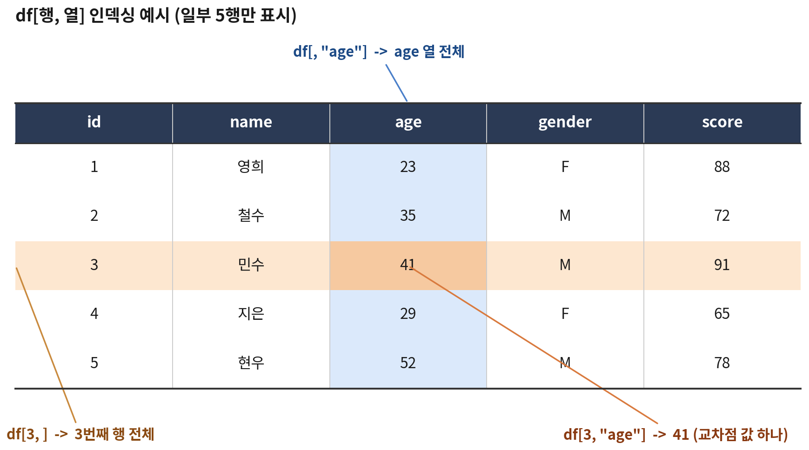

```{r}
#| include: false
source("_common.R")
```

::: {.doc}
::: {.session-meta}
<span>내용: 데이터 불러오기, 구조 파악 함수, 결측 코드 정리, `[행, 열]` 인덱싱 · 슬라이싱, 조건 선택, 정렬, 열 수정</span>
<span>[슬라이드로 보기](d1-02-dataframe-1-slides.html)</span>
:::
:::

## 이번 시간에 할 일

::: {.incremental}
1. 데이터를 불러와서 **어떻게 생겼는지 파악**하기
2. 숨어 있는 **결측 코드** 찾아서 정리하기
3. 원하는 **행과 열만 골라내기** — `df[행, 열]`
4. 조건에 맞는 행 고르기, 정렬하기
5. 열 추가 · 수정 · 삭제
:::

::: {.doc}
실제 분석도 이 순서(불러오기 → 살펴보기 → 정리 → 가공)로 진행함. 이 시간은 R에 기본으로 들어 있는 문법(base R)만 사용하며, 오후에 배울 dplyr도 결국 같은 작업을 다른 문법으로 하는 것이어서 여기서 익힌 개념이 그대로 이어짐.
:::

# 데이터 불러오기 {background-color="#1f3a5f"}

## 실습 데이터 준비

```{r}
source("data/practice_data.R")
```

::: {.fragment}
| 객체 | 행 수 | 내용 |
|---|---|---|
| `fitness` | 30 | 체력측정 원자료 (성인 22건 + 어르신 8건) |
| `programs` | 15 | 측정 후 운동처방 프로그램 참여 기록 (5·6교시) |
:::

::: {.doc}
`source()`는 R 스크립트 파일을 통째로 실행하는 함수임. `practice_data.R` 안에 데이터를 만드는 코드가 들어 있어서, 실행하면 Environment 창에 두 데이터프레임이 생김. 국민체력100 측정 자료와 비슷한 구조로 만든 가상 데이터이며, 1교시에 직접 만든 `member`는 `fitness`의 앞 10명과 같음.
:::

## 파일에서 불러오기

```{r}
fitness_csv <- read.csv("data/fitness.csv")
dim(fitness_csv)
```

::: {.fragment}
| 파일 형식 | 함수 | 패키지 |
|---|---|---|
| CSV | `read.csv("파일.csv")` | 기본 R |
| 엑셀 | `read_excel("파일.xlsx", sheet = 1)` | readxl |
| SPSS | `read_sav("파일.sav")` | haven |
| SAS / Stata | `read_sas()`, `read_dta()` | haven |
:::

::: {.doc}
::: {.callout-warning title="한글 깨짐"}
Windows에서 엑셀로 저장한 CSV는 인코딩이 CP949인 경우가 많음. 한글이 깨지면 `read.csv("파일.csv", fileEncoding = "CP949")` 또는 `fileEncoding = "UTF-8"`을 지정해서 다시 불러옴. 공공데이터포털 등에서 내려받은 CSV도 인코딩을 먼저 확인하는 것이 좋음.
:::

경로는 프로젝트 폴더 기준의 상대경로로 씀. `data/fitness.csv`는 "프로젝트 폴더 안의 data 폴더 안의 fitness.csv"라는 뜻임. 현재 작업 디렉토리는 `getwd()`로 확인할 수 있음.
:::

# 구조 파악 함수 {background-color="#1f3a5f"}

처음 받은 데이터에서 가장 먼저 하는 일

## 크기와 이름

```{r}
#| output-location: column-fragment
dim(fitness)
nrow(fitness)
ncol(fitness)
names(fitness)
```

::: {.doc}
`dim()`은 (행 수, 열 수)를 함께 돌려줌. `names()`와 `colnames()`는 같은 결과를 줌. 열 이름은 이후 모든 작업에서 계속 쓰므로 철자를 정확히 확인해 두는 것이 좋음.

| 열 | 내용 | 국민체력100 항목 |
|---|---|---|
| `id` | 측정 번호 (A: 성인, E: 어르신) | |
| `stage` | 연령 단계 (성인 / 어르신) | |
| `sex`, `age` | 성별, 나이 | |
| `center`, `region` | 측정 센터, 센터 지역 | |
| `exercise` | 운동 빈도 | |
| `height`, `weight` | 키(cm), 몸무게(kg) | 신체조성(BMI) |
| `fat_pct` | 체지방률(%) | 신체조성 |
| `grip` | 악력(kg) | 근력(상대악력) |
| `situp` | 교차윗몸일으키기(회) — 성인만 | 근지구력 |
| `sit_reach` | 앉아윗몸앞으로굽히기(cm) | 유연성 |
| `shuttle` | 20m 왕복오래달리기(회) — 성인만 | 심폐지구력 |
| `chair_stand` | 의자에앉았다일어서기(회) — 어르신만 | 근기능 |
| `walk_2min` | 2분제자리걷기(회) — 어르신만 | 심폐지구력 |
| `grade` | 인증 등급 (1~6등급) | |
:::

## 앞부분 · 뒷부분 보기

```{r}
#| output-location: slide
head(fitness)        # 앞 6행
tail(fitness, 3)     # 뒤 3행
```

::: {.fragment}
- 열이 많으면 화면 폭에 맞춰 여러 줄로 나뉘어 출력됨
- `View(fitness)` → 엑셀처럼 생긴 별도 창에서 보기 (정렬 · 검색 가능)
:::

## 구조 `str()`

```{r}
str(fitness)
```

::: {.doc}
`'data.frame': 30 obs. of 17 variables`는 30행 17열이라는 뜻임. 각 열의 자료형과 처음 몇 개의 값을 보여줌. 숫자여야 할 측정값 열이 `chr`(문자)로 나오면 문자가 섞여 있다는 신호임. `chair_stand`, `walk_2min`의 처음 값이 `NA`인 이유는 성인에게는 측정하지 않는 항목이기 때문임.
:::

## 요약 `summary()` — 이상한 값 찾기

```{r}
#| output-location: column-fragment
summary(fitness$age)
summary(fitness$grip)
summary(fitness$shuttle)
```

::: {.fragment}
- 나이 최솟값 `-9`, 최댓값 `999`?
- 악력 최댓값 `999`kg, 최솟값 `-1`kg?
- 왕복오래달리기 `-1`회? `NA's: 8`은 어르신 8명
:::

::: {.doc}
`summary()`는 숫자형 열의 최솟값, 1사분위수, 중앙값, 평균, 3사분위수, 최댓값과 결측 개수(`NA's`)를 보여줌. 최솟값이 음수이거나 최댓값이 비정상적으로 크면 결측 코드나 입력 오류를 의심해야 함. `summary(fitness)`로 모든 열을 한 번에 볼 수도 있음.
:::

## 범주형 열 살펴보기

```{r}
#| output-location: column-fragment
table(fitness$stage)
table(fitness$sex)
table(fitness$exercise)
table(fitness$grade)
```

::: {.fragment}
성별 `"미상"`, 운동 빈도 `""`(빈 칸), 등급 `"측정중단"`도 결측
:::

## 구조 파악 함수 정리

| 함수 | 하는 일 | 함수 | 하는 일 |
|---|---|---|---|
| `dim()` | 행 수, 열 수 | `str()` | 열별 자료형과 값 미리보기 |
| `nrow()` / `ncol()` | 행 수 / 열 수 | `summary()` | 열별 요약통계 |
| `names()` | 열 이름 | `table()` | 값별 빈도 |
| `head()` / `tail()` | 앞 / 뒤 몇 행 | `unique()` | 중복 없는 값 목록 |
| `View()` | 표 형태로 보기 | `prop.table()` | 빈도를 비율로 |

::: {.fragment}
::: {.box}
데이터를 받으면 `dim()` → `str()` → `summary()` · `table()` 순서로 한 번씩 돌려 보는 습관을 들이면 대부분의 문제를 초기에 발견할 수 있음
:::
:::

# 결측 코드 정리 {background-color="#1f3a5f"}

## 두 종류의 결측

```{r}
#| output-location: column-fragment
sum(is.na(fitness))
colSums(is.na(fitness))
```

::: {.fragment}
| 종류 | 예 | R이 알아보는가 |
|---|---|---|
| 진짜 `NA` | 성인의 `chair_stand`, 어르신의 `shuttle` | O |
| 결측 코드 | `-9`, `999`, `-1`, `"미상"`, `""`, `"측정중단"` | **X** |
:::

::: {.doc}
`is.na()`는 R이 진짜 `NA`로 저장한 값만 찾아냄. 여기서 잡힌 60개는 모두 "해당 연령 단계에서 측정하지 않는 항목"임. 측정 거부나 입력 오류를 뜻하는 `-9`, `999` 같은 코드는 R 입장에서는 정상적인 숫자이므로 `is.na()`로 찾을 수 없고, 그대로 두면 평균 등이 왜곡됨. 어떤 값이 결측 코드인지는 반드시 코드북(자료 설명서)에서 확인해야 함.
:::

::: {.notes}
- 수강생에게 앞 슬라이드의 이상한 값을 다시 짚어 보게 하기
:::

## 결측 코드를 `NA`로 바꾸기

```{r}
#| code-line-numbers: "|1|2|3|4|5-7|9"
fit <- fitness                                   # 원자료는 그대로 두고 복사본에서 작업
fit$age[fit$age %in% c(-9, 999)]     <- NA
fit$grip[fit$grip %in% c(-1, 999)]   <- NA
fit$shuttle[fit$shuttle == -1]       <- NA
fit$sex[fit$sex == "미상"]           <- NA
fit$exercise[fit$exercise == ""]     <- NA
fit$grade[fit$grade == "측정중단"]   <- NA

colSums(is.na(fit))
```

::: {.doc}
`fit$age[조건] <- NA`는 "age 열에서 조건이 TRUE인 위치에 NA를 넣어라"라는 뜻으로, 1교시 벡터 조건 인덱싱(`grip[grip > 40]`)에 값을 넣는 방식임. 원자료(`fitness`)를 보존하기 위해 복사본(`fit`)에서 작업함. 이후 실습은 모두 정리된 `fit`을 사용함.
:::

## 정리 전후 비교

```{r}
#| output-location: column-fragment
mean(fitness$grip)               # 결측 코드 그대로: 왜곡
mean(fit$grip)                   # NA가 있으면 NA
mean(fit$grip, na.rm = TRUE)     # NA 빼고 계산

summary(fit$age)
```

::: {.doc}
::: {.callout-caution title="조심"}
`na.rm = TRUE`는 결측을 빼고 계산하라는 뜻임. `fit`에는 측정하지 않는 항목(연령 단계별)과 결측 코드에서 바뀐 `NA`가 함께 있으므로, 평균을 구할 때 `na.rm = TRUE`가 자주 필요함. `na.omit(fit)`은 어느 열이든 결측이 하나라도 있는 행을 통째로 지우는데, 이 데이터에서는 모든 행에 해당 없는 항목의 `NA`가 있어서 0행이 됨. 필요한 열만 고른 뒤에 적용해야 함.
:::
:::

# 인덱싱과 슬라이싱 {background-color="#1f3a5f"}

`df[행, 열]`

## `$`로 열 하나 꺼내기

```{r}
#| output-location: column-fragment
fit$grip
fit$center
class(fit$grip)
mean(fit$grip, na.rm = TRUE)
```

::: {.fragment}
- `df$열이름` → 열 하나를 **벡터**로 꺼냄
- RStudio에서 `fit$`까지 치면 열 이름 자동완성
:::

## `df[행, 열]` 기본 문법

:::: {.columns}
::: {.column width="50%"}

:::

::: {.column width="50%"}
- 대괄호 안을 콤마로 나눔
- 콤마 **앞 = 행**, 콤마 **뒤 = 열**
- 비워두면 **전체**
- 번호, 이름, 조건(TRUE/FALSE) 모두 가능
:::
::::

## 행 · 열 · 셀 선택

::: {.panel-tabset}
### 행

```{r}
fit[3, ]           # 3행 전체
fit[c(1, 23), ]    # 1행과 23행 (성인 1명, 어르신 1명)
```

### 열

```{r}
fit[, 11]          # 11번째 열 → 벡터
fit[, "grip"]      # 이름으로 → 벡터
```

### 행과 열

```{r}
fit[3, "grip"]                      # 셀 하나
fit[c(1, 23), c("id", "stage", "grip")]
```
:::

::: {.doc}
::: {.callout-important title="확인"}
`fit[3, ]`(3행 전체)와 `fit[, 3]`(3열 전체)은 완전히 다른 결과임. 콤마 위치를 항상 확인해야 함.
:::
:::

## 슬라이싱: 범위로 자르기

```{r}
#| output-location: fragment
fit[1:3, 1:6]
fit[21:24, c("id", "stage", "age", "situp", "chair_stand")]
fit[-(1:27), c("id", "age", "grip")]
```

::: {.doc}
`1:3`처럼 범위를 주면 연속된 행·열을 잘라냄(슬라이싱). 두 번째 줄은 성인과 어르신의 경계(22행과 23행)를 잘라 본 것으로, 해당 없는 항목이 `NA`인 것을 확인할 수 있음. 음수는 해당 위치를 빼라는 뜻이어서 `fit[-(1:27), ]`은 1~27행을 뺀 나머지(28~30행)가 됨. `-1:27`이라고 쓰면 `-1, 0, 1, …, 27`로 해석되어 오류가 나므로 괄호가 필요함.
:::

## 여러 열 선택

```{r}
#| output-location: fragment
head(fit[, c("id", "sex", "age", "height", "weight")])
head(fit[, -(7:17)])
```

::: {.doc}
열 번호로 고르면 데이터 구조가 바뀌었을 때(열이 추가·삭제되었을 때) 엉뚱한 열이 선택될 수 있음. 가능하면 열 이름으로 고르는 것이 안전함. `head()`로 감싸면 앞 6행만 보여줌.
:::

## 열 하나만 고르면 벡터가 됨

```{r}
#| output-location: column-fragment
class(fit[, "grip"])
class(fit[, c("id", "grip")])

fit[1:3, "grip", drop = FALSE]
class(fit["grip"])
```

::: {.fragment}
::: {.callout-note title="참고"}
열을 **하나만** 고르면 R이 자동으로 벡터로 바꿈. 데이터프레임 모양을 유지하려면 `drop = FALSE`를 쓰거나 콤마 없이 `fit["grip"]`처럼 씀
:::
:::

# 조건으로 행 고르기 {background-color="#1f3a5f"}

## 조건 → TRUE/FALSE → 행 선택 {auto-animate=true}

```{r}
fit$stage == "어르신"
```

::: {.only-slides}
## 조건 → TRUE/FALSE → 행 선택 {auto-animate=true}

```{r}
fit$stage == "어르신"
fit[fit$stage == "어르신", ]
```

## 조건 → TRUE/FALSE → 행 선택 {auto-animate=true}

```{r}
fit$stage == "어르신"
fit[fit$stage == "어르신", c("id", "age", "grip", "chair_stand")]
```

TRUE인 행만 남고, 콤마 뒤로 열까지 함께 고를 수 있음
:::

::: {.doc}
```{r}
fit[fit$stage == "어르신", c("id", "age", "grip", "chair_stand")]
```

조건식은 행 수만큼의 TRUE/FALSE 벡터를 만들고, 이 벡터를 콤마 앞(행 자리)에 넣으면 TRUE인 행만 남음. 1교시 벡터 인덱싱 `grip[grip > 40]`과 같은 원리임. 콤마 뒤에 열 이름을 넣으면 행과 열을 동시에 고를 수 있음.
:::

## 여러 조건 결합

::: {.panel-tabset}
### 그리고 `&`

```{r}
# 성인이면서 남성
fit[fit$stage == "성인" & fit$sex == "M", c("id", "sex", "age", "grip")]
```

### 또는 `|`

```{r}
# 주 3회 이상 운동하거나 1등급
fit[fit$exercise == "주 3회 이상" | fit$grade == "1등급", c("id", "exercise", "grade")]
```

### 여러 값 중 하나 `%in%`

```{r}
fit[fit$center %in% c("가람", "다온"), c("id", "center", "region")]
```
:::

::: {.doc}
`|` 결과에 `NA`로만 채워진 행이 보이면, 조건 계산에 쓰인 열(`exercise`, `grade`)에 `NA`가 있기 때문임. 다음 슬라이드에서 다룸.
:::

## 조건에 `NA`가 있으면

```{r}
#| output-location: fragment
fit[fit$grip >= 40, c("id", "sex", "grip")]
```

## `which()` · `subset()`로 해결

```{r}
#| output-location: column-fragment
fit[which(fit$grip >= 40), c("id", "sex", "grip")]
subset(fit, grip >= 40, select = c(id, sex, grip))
```

::: {.doc}
악력이 `NA`인 행은 조건 결과도 `NA`가 되어, 대괄호 인덱싱에서는 모든 값이 `NA`인 행으로 나타남. `which()`로 TRUE인 위치만 뽑거나 `subset()`을 쓰면 `NA` 행이 빠짐. 오후에 배울 dplyr `filter()`도 `NA` 행을 자동으로 뺌.
:::

## 조건에 맞는 개수 · 위치

```{r}
#| output-location: column-fragment
sum(fit$stage == "어르신")          # 몇 명?
mean(fit$exercise == "주 3회 이상", na.rm = TRUE)   # 비율
which(fit$grade == "1등급")          # 몇 번째 행?
fit$id[which(fit$grade == "1등급")]  # 1등급 측정 번호
mean(fit$grip[fit$sex == "F"], na.rm = TRUE)
```

::: {.doc}
마지막 줄은 "여성 측정자의 악력 벡터"를 먼저 꺼낸 뒤 평균을 구한 것임. 성별·연령 단계별 평균을 구할 때 이렇게 쓰면 집단 수만큼 코드를 반복해야 하는데, 오후에 배울 `group_by()` + `summarize()`로 한 번에 해결할 수 있음.
:::

# 정렬 {background-color="#1f3a5f"}

## `order()`로 정렬

```{r}
#| output-location: column-fragment
order(fit$grip)
head(fit[order(fit$grip), c("id", "sex", "grip")])
```

::: {.fragment}
- `order()`는 정렬된 값이 아니라 **정렬 순서(행 번호)** 를 돌려줌
- 이 순서를 행 자리에 넣으면 정렬된 데이터프레임
- `NA`는 맨 뒤로 감
:::

## 내림차순 · 여러 기준

```{r}
#| output-location: fragment
# 악력 내림차순
head(fit[order(fit$grip, decreasing = TRUE), c("id", "sex", "grip")])

# 연령 단계로 묶고, 그 안에서 앉아윗몸앞으로굽히기 내림차순
fit[order(fit$stage, -fit$sit_reach), c("id", "stage", "sit_reach")]
```

::: {.doc}
::: {.callout-warning title="주의"}
정렬 결과를 저장하지 않으면 원본 `fit`은 그대로임. 정렬된 상태를 계속 쓰려면 `fit_sorted <- fit[order(fit$grip), ]`처럼 새 객체에 저장함. 숫자 열 앞의 `-`는 내림차순을 뜻하며 문자 열에는 쓸 수 없음.
:::
:::

# 열 추가 · 수정 · 삭제 {background-color="#1f3a5f"}

## 새 열 만들기

```{r}
#| code-line-numbers: "|1|2|3"
fit$bmi      <- round(fit$weight / (fit$height / 100)^2, 1)   # BMI
fit$grip_rel <- round(fit$grip / fit$weight * 100, 1)          # 상대악력(%)
fit$active   <- fit$exercise == "주 3회 이상"                  # 논리형
head(fit[, c("id", "bmi", "grip", "grip_rel", "exercise", "active")])
```

::: {.doc}
`df$새열이름 <- 값` 형태로 쓰면 열이 추가됨. 이미 있는 열 이름을 쓰면 그 열이 덮어써짐. 열끼리의 계산은 같은 행끼리 이루어지므로(1교시 벡터 연산), 측정자마다 BMI와 상대악력이 한 번에 계산됨.
:::

## 조건으로 값 나누기 — `ifelse()` · `cut()`

```{r}
#| output-location: fragment
fit$bmi_grp <- ifelse(fit$bmi < 18.5, "저체중",
               ifelse(fit$bmi < 23,   "정상",
               ifelse(fit$bmi < 25,   "과체중", "비만")))
table(fit$bmi_grp)

fit$age_grp <- cut(fit$age,
                   breaks = c(18, 39, 64, Inf),
                   labels = c("19~39세", "40~64세", "65세 이상"))
table(fit$age_grp, useNA = "ifany")
```

::: {.doc}
`ifelse(조건, 참일 때 값, 거짓일 때 값)`을 겹쳐 쓰면 여러 구간으로 나눌 수 있음. 18.5 / 23 / 25는 아시아-태평양 기준 BMI 구간임. `cut()`은 숫자를 구간으로 나누는 함수로, `breaks`는 구간 경계임(`c(18, 39, 64, Inf)`는 (18, 39], (39, 64], (64, ∞) 세 구간). `cut()`의 결과는 팩터이므로 순서가 자동으로 유지됨. `useNA = "ifany"`는 `NA`도 빈도표에 함께 보여 달라는 뜻임(나이가 결측인 2명). 오후에는 같은 작업을 `case_when()`으로 더 읽기 쉽게 함.
:::

## 값 수정 · 이름 변경 · 열 삭제

```{r}
#| code-line-numbers: "|1-2|4-5|7-8"
# 특정 셀 값 수정 (재측정 결과 반영)
fit[3, "grip"] <- 41.8

# 열 이름 바꾸기
names(fit)[names(fit) == "fat_pct"] <- "fat"

# 열 삭제 (NULL 할당)
fit$active <- NULL
names(fit)
```

::: {.doc}
`names(fit) == "fat_pct"`는 열 이름 중 `"fat_pct"` 위치만 TRUE인 논리 벡터이고, 그 자리의 이름만 새 이름으로 바꾸는 방식임. 오후에 배울 `rename()`을 쓰면 `rename(fit, fat = fat_pct)`로 간단해짐.
:::

## 정리

| 작업 | base R 문법 |
|---|---|
| 구조 파악 | `dim()`, `str()`, `summary()`, `table()` |
| 결측 코드 → NA | `df$col[df$col %in% c(-9, 999)] <- NA` |
| 열 하나 | `df$col`, `df[, "col"]`, `df[["col"]]` |
| 행 · 열 선택 | `df[행, 열]`, `df[1:3, c("a", "b")]` |
| 조건으로 행 선택 | `df[which(df$age >= 40), ]`, `subset(df, age >= 40)` |
| 정렬 | `df[order(df$col), ]`, `order(-df$col)` |
| 새 열 | `df$new <- 계산식`, `ifelse()`, `cut()` |
| 열 삭제 · 이름 변경 | `df$col <- NULL`, `names(df)[...] <- "new"` |

## 실습 · 체력측정 데이터 {.exercise}

<div class="timer" data-min="10"></div>

`fitness`를 다시 정리한 `fit` 사용 (결측 코드 정리 슬라이드의 코드를 한 번 더 실행)

1. 연령 단계(`stage`)별, 센터(`center`)별 인원 구하기
2. 1등급 · 2등급인 사람의 비율 구하기
3. 성인 중 왕복오래달리기(`shuttle`) 40회 이상인 사람의 `id`, `sex`, `age`, `shuttle`을 `shuttle` 내림차순으로 보기
4. 남성의 평균 악력과 여성의 평균 악력 구하기
5. 어르신의 의자에앉았다일어서기(`chair_stand`) 평균과, 성인의 교차윗몸일으키기(`situp`) 평균 구하기

::: {.answer title="정답"}
```{r}
fit <- fitness
fit$age[fit$age %in% c(-9, 999)]   <- NA
fit$grip[fit$grip %in% c(-1, 999)] <- NA
fit$shuttle[fit$shuttle == -1]     <- NA
fit$sex[fit$sex == "미상"]         <- NA
fit$exercise[fit$exercise == ""]   <- NA
fit$grade[fit$grade == "측정중단"] <- NA
# 1
table(fit$stage); table(fit$center)
# 2
mean(fit$grade %in% c("1등급", "2등급"))
# 3
run <- subset(fit, stage == "성인" & shuttle >= 40, select = c(id, sex, age, shuttle))
run[order(-run$shuttle), ]
# 4
mean(fit$grip[which(fit$sex == "M")], na.rm = TRUE)
mean(fit$grip[which(fit$sex == "F")], na.rm = TRUE)
# 5
mean(fit$chair_stand[fit$stage == "어르신"])
mean(fit$situp[fit$stage == "성인"])
```
:::
