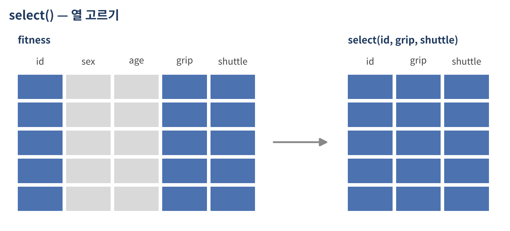
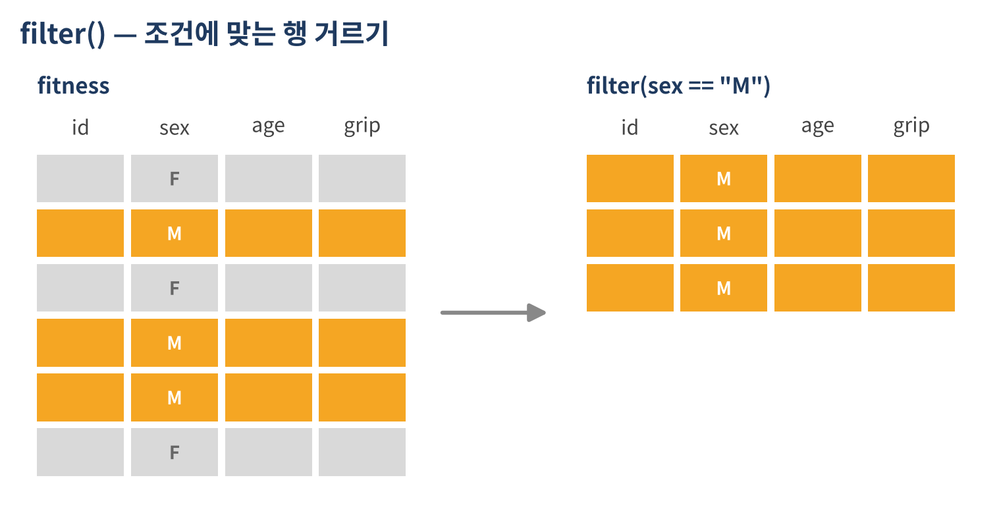
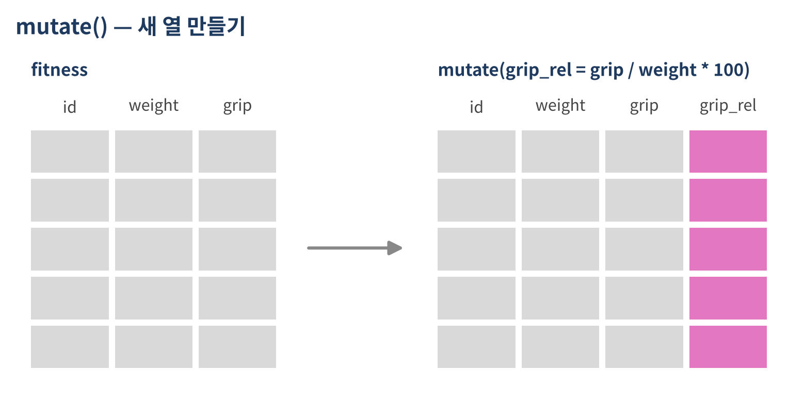

```{r}
#| include: false
source("_common.R")
```

::: {.doc}
::: {.session-meta}
<span>내용: dplyr 소개, 파이프 `%>%`, select · filter · mutate · arrange, base R과 비교, 결측 코드 정리 파이프라인</span>
<span>[슬라이드로 보기](d1-03-dataframe-2-slides.html)</span>
:::
:::

## 오전에 했던 작업, 다시 보기

```{r}
#| eval: false
run <- subset(fit, stage == "성인" & shuttle >= 40, select = c(id, sex, age, shuttle))
run[order(-run$shuttle), ]
```

::: {.fragment}
같은 작업을 dplyr로 쓰면

```{r}
#| eval: false
fit %>%
  filter(stage == "성인", shuttle >= 40) %>%
  select(id, sex, age, shuttle) %>%
  arrange(desc(shuttle))
```
:::

::: {.fragment}
- `fit$`를 반복하지 않음
- 위에서 아래로 **작업 순서대로** 읽힘: 거르고 → 고르고 → 정렬
:::

# dplyr 시작하기 {background-color="#1f3a5f"}

## dplyr란

::: {.incremental}
- 데이터프레임을 다루기 위한 패키지 (tidyverse 패키지 묶음 중 하나)
- 데이터 작업을 **동사(verb)** 함수로 표현

| 동사 | 하는 일 | base R |
|---|---|---|
| `select()` | 열 고르기 | `df[, c("a", "b")]` |
| `filter()` | 행 거르기 | `df[df$a > 1, ]` |
| `mutate()` | 열 만들기 · 바꾸기 | `df$new <- ...` |
| `arrange()` | 정렬 | `df[order(df$a), ]` |
| `group_by()` + `summarize()` | 집단별 요약 | `tapply()`, `aggregate()` |
| `*_join()` | 데이터 결합 | `merge()` |
:::

::: {.notes}
- 오늘 오후 4시간 동안 이 표의 내용을 전부 다룸
- 3·4교시: 위 4개 / 5·6교시: group_by, join
:::

## 설치와 불러오기

```{r}
#| eval: false
install.packages("dplyr")   # 최초 1회
```

```{r}
#| message: true
library(dplyr)
```

::: {.doc}
::: {.callout-note title="참고"}
`library(dplyr)`을 실행하면 `filter`, `lag` 등이 다른 패키지의 같은 이름 함수를 가린다(masked)는 메시지가 나옴. 오류가 아니라 안내 메시지이므로 무시해도 됨. 이후 `filter()`를 쓰면 dplyr의 `filter()`가 실행됨.
:::
:::

## 실습 데이터 준비 (2교시 정리 코드)

```{r}
source("data/practice_data.R")

fit <- fitness
fit$age[fit$age %in% c(-9, 999)]   <- NA
fit$grip[fit$grip %in% c(-1, 999)] <- NA
fit$shuttle[fit$shuttle == -1]     <- NA
fit$sex[fit$sex == "미상"]         <- NA
fit$exercise[fit$exercise == ""]   <- NA
fit$grade[fit$grade == "측정중단"] <- NA

fit <- as_tibble(fit)
```

::: {.doc}
2교시 마지막에 만든 정리본 `fit`을 다시 만듦. `as_tibble()`은 데이터프레임을 tibble 형태로 바꿈. tibble은 dplyr에서 쓰는 데이터프레임으로, 출력할 때 앞의 몇 행만 보여주고 열마다 자료형(`<chr>`, `<dbl>`)을 표시해 줘서 보기 편함. 기능은 데이터프레임과 같음. 같은 정리 작업을 이 시간 마지막에 dplyr로 다시 해봄.
:::

## `glimpse()` — 열 기준으로 훑어보기

```{r}
glimpse(fit)
```

::: {.fragment}
`str()`의 dplyr 버전. 열이 많은 데이터에서 특히 편함
:::

# 파이프 `%>%` {background-color="#1f3a5f"}

## 파이프: 왼쪽 결과를 오른쪽 함수로

```{r}
#| output-location: column-fragment
x <- c(42.1, 21.7, 41.4, NA)

mean(x, na.rm = TRUE)
x %>% mean(na.rm = TRUE)

round(mean(x, na.rm = TRUE), 1)
x %>% mean(na.rm = TRUE) %>% round(1)
```

::: {.fragment}
- `x %>% f(y)` 는 `f(x, y)` 와 같음
- 단축키: `Ctrl + Shift + M` (Mac: `Cmd + Shift + M`)
- "그리고 나서(and then)"라고 읽으면 됨
:::

## 괄호 겹치기 vs 파이프

::: {.panel-tabset}
### 괄호 겹치기

```{r}
arrange(select(filter(fit, stage == "성인"), id, age, shuttle), desc(shuttle))
```

### 중간 객체

```{r}
step1 <- filter(fit, stage == "성인")
step2 <- select(step1, id, age, shuttle)
arrange(step2, desc(shuttle))
```

### 파이프

```{r}
fit %>%
  filter(stage == "성인") %>%
  select(id, age, shuttle) %>%
  arrange(desc(shuttle))
```
:::

::: {.doc}
세 방법의 결과는 같음. 괄호를 겹치면 안쪽부터 읽어야 해서 순서를 파악하기 어렵고, 중간 객체를 만들면 쓸모없는 객체가 쌓임. 파이프는 작업 순서대로 위에서 아래로 읽힘.
:::

## 파이프라인을 한 줄씩 쌓기 {auto-animate=true}

```{r}
fit
```

::: {.only-slides}
## 파이프라인을 한 줄씩 쌓기 {auto-animate=true}

```{r}
fit %>%
  filter(stage == "성인")
```

## 파이프라인을 한 줄씩 쌓기 {auto-animate=true}

```{r}
fit %>%
  filter(stage == "성인") %>%
  select(id, age, shuttle)
```

## 파이프라인을 한 줄씩 쌓기 {auto-animate=true}

```{r}
fit %>%
  filter(stage == "성인") %>%
  select(id, age, shuttle) %>%
  arrange(desc(shuttle))
```

한 줄 추가할 때마다 실행해서 결과를 확인하는 방식으로 작성
:::

::: {.doc}
파이프라인은 한 번에 완성하지 않고, 한 줄 추가할 때마다 실행해서 결과를 확인하며 쌓아가는 것이 좋음. 중간에 오류가 나면 어느 단계에서 문제가 생겼는지 바로 알 수 있음.
:::

## `%>%` 와 `|>`

| | `%>%` | `|>` |
|---|---|---|
| 출처 | magrittr 패키지 (dplyr와 함께 불러와짐) | R 4.1 이상 기본 기능 |
| 사용 | `x %>% f()` | `x |> f()` |

::: {.doc}
두 파이프는 일반적인 사용에서는 같게 동작함. 이 자료는 `%>%`로 통일함. 인터넷 자료에서 `|>`를 보면 같은 뜻으로 읽으면 됨. RStudio의 Tools → Global Options → Code → "Use native pipe operator"를 켜면 단축키가 `|>`를 입력함.
:::

::: {.fragment}
::: {.callout-warning title="파이프 줄바꿈"}
`%>%`는 **줄 끝**에 둠. 줄 맨 앞에 두면 앞 줄에서 명령이 끝난 것으로 인식되어 오류가 남
:::
:::

# `select()` — 열 고르기 {background-color="#1f3a5f"}

## `select()`

{.diagram}

```{r}
#| output-location: fragment
fit %>% select(id, grip, sit_reach)
```

## 범위 · 제외 · 순서 바꾸기

::: {.panel-tabset}
### 범위 `:`

```{r}
fit %>% select(sex:region)
```

### 제외 `-`

```{r}
fit %>% select(-center, -region, -exercise)
```

### 순서 `everything()`

```{r}
fit %>% select(grade, stage, everything())
```

### 고르면서 이름 바꾸기

```{r}
fit %>% select(id, 악력 = grip, 등급 = grade)
```
:::

## 조건으로 열 고르기 — 도우미 함수

```{r}
#| output-location: column-fragment
fit %>% select(contains("sit"))
fit %>% select(starts_with("s"))
fit %>% select(where(is.character))
```

::: {.doc}
| 도우미 함수 | 고르는 열 |
|---|---|
| `starts_with("s")` | 이름이 "s"로 시작하는 열 (`stage`, `sex`, `situp`, `sit_reach`, `shuttle`) |
| `ends_with("_pct")` | 이름이 "_pct"로 끝나는 열 |
| `contains("sit")` | 이름에 "sit"가 들어간 열 (`situp`, `sit_reach`) |
| `where(is.numeric)` | 숫자형 열 |
| `where(is.character)` | 문자형 열 |
| `everything()` | 나머지 모든 열 |

측정 항목이 수십 개인 자료에서 `grip_left`, `grip_right`처럼 이름이 비슷한 열 묶음을 고를 때 `starts_with("grip")`처럼 쓰면 편함.
:::

## `rename()` · `relocate()` · `pull()`

```{r}
#| code-line-numbers: "|1|2|3"
fit %>% rename(fat = fat_pct, flex = sit_reach)
fit %>% relocate(grade, .after = id)
fit %>% pull(grip) %>% mean(na.rm = TRUE)
```

::: {.doc}
- `rename(새이름 = 옛이름)`: 열 이름만 바꾸고 나머지 열은 그대로 둠
- `relocate()`: 열 순서만 바꿈. `.before`, `.after`로 위치 지정
- `pull()`: 열 하나를 벡터로 꺼냄 (`fit$grip`과 같음). `select(grip)`은 1열짜리 데이터프레임을 돌려주므로 `mean()`에 바로 넣을 수 없음
:::

# `filter()` — 행 거르기 {background-color="#1f3a5f"}

## `filter()`

{.diagram}

```{r}
#| output-location: fragment
fit %>% filter(grip >= 42)
```

## 여러 조건

::: {.panel-tabset}
### 그리고 `,` `&`

```{r}
# 콤마(,)는 &와 같음
fit %>% filter(stage == "어르신", sex == "F")
```

### 또는 `|`

```{r}
fit %>% filter(age < 30 | age >= 75)
```

### `%in%`

```{r}
fit %>% filter(grade %in% c("1등급", "2등급"))
```

### 구간 `between()`

```{r}
fit %>% filter(between(age, 40, 49))
```

### 부정 `!`

```{r}
fit %>% filter(!center %in% c("가람", "누리"))
```
:::

::: {.doc}
`between(age, 40, 49)`는 `age >= 40 & age <= 49`와 같음(양 끝 포함). `!center %in% c(...)`는 "목록에 포함되지 않는"이라는 뜻임.
:::

## 자주 하는 실수

::: {.panel-tabset}
### `=` 와 `==`

```{r}
#| error: true
fit %>% filter(sex = "F")
```

비교는 `==`. `=` 하나는 인자 지정

### 문자는 정확히

```{r}
fit %>% filter(grade == "1 등급") %>% nrow()
fit %>% filter(grade == "1등급") %>% nrow()
```

공백 하나만 달라도 다른 값

### `NA`는 빠짐

```{r}
fit %>% filter(shuttle < 20) %>% select(id, stage, shuttle)
fit %>% filter(shuttle < 20 | is.na(shuttle)) %>% select(id, stage, shuttle)
```

조건 결과가 `NA`인 행은 제외됨
:::

::: {.doc}
`filter()`는 조건이 TRUE인 행만 남기고 FALSE와 NA인 행은 모두 버림. 2교시 대괄호 인덱싱에서 생기던 `NA` 행 문제가 없는 대신, 측정하지 않은 행(어르신의 `shuttle`)이 말없이 빠진다는 점을 기억해야 함. 결측 행만 보고 싶으면 `filter(is.na(shuttle))`를 씀.
:::

## 행 번호 · 상위 몇 개로 고르기 — `slice_*()`

::: {.panel-tabset}
### `slice()`

```{r}
fit %>% slice(1:3)
```

### `slice_max()`

```{r}
fit %>% slice_max(shuttle, n = 3)
```

### `slice_min()`

```{r}
fit %>% slice_min(fat_pct, n = 3)
```

### `slice_sample()`

```{r}
fit %>% slice_sample(n = 3)
```
:::

::: {.doc}
| 함수 | 고르는 행 |
|---|---|
| `slice(1:3)` | 1~3번째 행 (`df[1:3, ]`와 같음) |
| `slice_head(n = 5)` / `slice_tail(n = 5)` | 앞 / 뒤 5행 |
| `slice_max(shuttle, n = 3)` | `shuttle`이 큰 3행 (동점이면 더 나올 수 있음) |
| `slice_min(fat_pct, n = 3)` | `fat_pct`가 작은 3행 |
| `slice_sample(n = 3)` | 무작위 3행 |
:::

## 실습 A · select와 filter {.exercise}

<div class="timer" data-min="10"></div>

`fit` 데이터 사용

1. `id`, `age`, `grip`만 골라서 보기
2. `center`, `region`을 빼고 나머지 열만 보기
3. 1등급을 받은 여성은 몇 명인가 (`nrow()` 사용)
4. 75세 이상이거나 왕복오래달리기 50회 이상인 측정자의 `id`, `age`, `shuttle`
5. 성인 남성 중 악력 상위 3명

::: {.answer title="실습 A 정답"}
```{r}
fit %>% select(id, age, grip)
fit %>% select(-center, -region)
fit %>% filter(grade == "1등급", sex == "F") %>% nrow()
fit %>% filter(age >= 75 | shuttle >= 50) %>% select(id, age, shuttle)
fit %>% filter(stage == "성인", sex == "M") %>% slice_max(grip, n = 3)
```
:::

# `mutate()` — 열 만들기 · 바꾸기 {background-color="#1f3a5f"}

## `mutate()`

{.diagram}

```{r}
#| output-location: fragment
fit %>%
  mutate(grip_rel = grip / weight * 100) %>%
  select(id, weight, grip, grip_rel)
```

## 여러 열을 한 번에

```{r}
#| code-line-numbers: "|2|3|4|5"
fit %>% mutate(
  bmi      = weight / (height / 100)^2,      # 새 열
  bmi      = round(bmi, 1),                  # 방금 만든 열을 바로 다시 사용
  grip_rel = round(grip / weight * 100, 1),  # 상대악력(%)
  age      = as.integer(age)                 # 기존 열 덮어쓰기
) %>%
  select(id, height, weight, bmi, grip, grip_rel)
```

::: {.doc}
`mutate()` 안에서는 콤마로 여러 열을 동시에 만들 수 있고, 앞에서 만든 열을 뒤에서 바로 쓸 수 있음. 기존 열과 같은 이름을 쓰면 그 열을 덮어씀. 결과를 저장하려면 `fit <- fit %>% mutate(...)`처럼 다시 할당해야 함.
:::

## 조건에 따라 값 정하기 — `if_else()`

```{r}
#| output-location: fragment
fit %>%
  mutate(
    bmi   = weight / (height / 100)^2,
    obese = if_else(bmi >= 25, "비만", "비만 아님"),
    top   = if_else(grade %in% c("1등급", "2등급"), 1, 0)
  ) %>%
  select(id, bmi, obese, grade, top)
```

::: {.doc}
`if_else(조건, 참일 때, 거짓일 때)`는 base R `ifelse()`의 dplyr 버전임. 참일 때 값과 거짓일 때 값의 자료형이 같아야 한다는 점이 더 엄격함(`if_else(x > 1, "a", 0)`은 오류). 실수를 미리 잡아준다는 장점이 있음.
:::

## 여러 구간 나누기 — `case_when()`

:::: {.columns}
::: {.column width="50%"}
```{r}
#| eval: false
# base R: 중첩 ifelse
ifelse(bmi < 18.5, "저체중",
ifelse(bmi < 23,   "정상",
ifelse(bmi < 25,   "과체중",
                   "비만")))
```
:::

::: {.column width="50%"}
```{r}
#| eval: false
# dplyr: case_when
case_when(
  bmi < 18.5 ~ "저체중",
  bmi < 23   ~ "정상",
  bmi < 25   ~ "과체중",
  .default   = "비만"
)
```
:::
::::

::: {.fragment}
- `조건 ~ 값` 을 위에서부터 차례로 검사, **처음 TRUE가 되는 값** 사용
- `.default` : 어느 조건에도 해당하지 않을 때 (`TRUE ~ 값` 으로 써도 같음)
:::

## `case_when()` 활용 · `NA` 주의

```{r}
#| output-location: slide
fit %>%
  mutate(
    bmi = weight / (height / 100)^2,
    bmi_grp = case_when(
      bmi < 18.5 ~ "저체중",
      bmi < 23   ~ "정상",
      bmi < 25   ~ "과체중",
      .default   = "비만"
    ),
    age_grp = case_when(
      age < 40  ~ "19~39세",
      age < 65  ~ "40~64세",
      age >= 65 ~ "65세 이상"
    ),
    age_grp_wrong = case_when(
      age < 40 ~ "19~39세",
      age < 65 ~ "40~64세",
      .default = "65세 이상"
    )
  ) %>%
  select(id, age, age_grp, age_grp_wrong, bmi, bmi_grp) %>%
  slice(10:15)
```

::: {.doc}
조건은 위에서부터 차례로 검사되므로 순서가 중요함. 예를 들어 `bmi < 23`을 `bmi < 18.5`보다 먼저 쓰면 저체중도 모두 "정상"으로 분류됨. 18.5 / 23 / 25는 아시아-태평양 기준 BMI 구간임.

나이가 `NA`인 행(A12)은 어느 조건도 TRUE가 아니므로, `.default`를 쓰면 "65세 이상"으로 잘못 분류됨(`age_grp_wrong`). 결측이 있는 열은 `.default` 대신 마지막 구간도 조건으로 적어서 `NA`가 그대로 남게 하는 것이 안전함.
:::

## 범주 순서 정하기 — `factor()`

```{r}
#| output-location: fragment
bmi_levels <- c("저체중", "정상", "과체중", "비만")
fit2 <- fit %>%
  mutate(
    bmi = weight / (height / 100)^2,
    bmi_grp = case_when(bmi < 18.5 ~ "저체중", bmi < 23 ~ "정상",
                        bmi < 25 ~ "과체중", .default = "비만"),
    bmi_grp = factor(bmi_grp, levels = bmi_levels)
  )

table(fit2$bmi_grp)
```

::: {.doc}
1교시에서 다룬 팩터를 `mutate()` 안에서 만드는 방식임. `factor()`를 쓰지 않으면 `table()` 결과가 문자 순서(과체중 → 비만 → 저체중 → 정상)로 나옴. BMI 구간·연령대·운동 빈도처럼 순서가 있는 범주는 분석 전에 순서를 정해 두면 표와 그래프, 회귀분석의 기준 범주가 의도대로 정해짐.
:::

## 여러 열에 같은 작업 — `across()`

```{r}
#| code-line-numbers: "|2"
fit %>%
  mutate(across(c(height, weight, fat_pct), round)) %>%
  select(id, height, weight, fat_pct)
```

::: {.doc}
`across(대상 열, 함수)`는 여러 열에 같은 함수를 적용함. 위 코드는 세 열을 각각 반올림한 것으로, `mutate(height = round(height), weight = round(weight), fat_pct = round(fat_pct))`를 한 번에 쓴 것과 같음.
:::

## `across()` — 측정 항목 표준화

```{r}
fit %>%
  mutate(across(c(grip, sit_reach, fat_pct),
                ~ (.x - mean(.x, na.rm = TRUE)) / sd(.x, na.rm = TRUE))) %>%
  select(id, grip, sit_reach, fat_pct)
```

::: {.doc}
세 측정 항목을 표준화(평균 0, 표준편차 1)한 것임. `~`(물결)는 함수를 짧게 쓰겠다는 표시이고, `.x`는 지금 처리 중인 열을 가리키는 자리 표시임. 단위가 다른 측정 항목(kg, cm, %)을 비교할 수 있는 척도로 바꿀 때 이런 표준화를 씀.
:::

# `arrange()` — 정렬 {background-color="#1f3a5f"}

## `arrange()`

::: {.panel-tabset}
### 오름차순

```{r}
fit %>% arrange(fat_pct)
```

### 내림차순 `desc()`

```{r}
fit %>% arrange(desc(sit_reach))
```

### 여러 기준

```{r}
fit %>% arrange(stage, desc(grip))
```
:::

::: {.doc}
기본은 오름차순이고 `desc()`로 감싸면 내림차순임. 여러 열을 쓰면 앞의 열 기준으로 먼저 정렬하고, 같은 값 안에서 다음 열 기준으로 정렬함. 문자형 열은 문자 순서이며, `NA`는 항상 맨 뒤로 감.
:::

# base R ↔ dplyr {background-color="#1f3a5f"}

2교시 작업을 dplyr로 다시

## 같은 작업, 다른 문법

::: {.panel-tabset}
### 열 고르기

```{r}
#| eval: false
# base R
fit[, c("id", "grip")]
# dplyr
fit %>% select(id, grip)
```

### 행 거르기

```{r}
#| eval: false
# base R
fit[which(fit$stage == "성인" & fit$sex == "M"), ]
# dplyr
fit %>% filter(stage == "성인", sex == "M")
```

### 새 열

```{r}
#| eval: false
# base R
fit$bmi <- fit$weight / (fit$height / 100)^2
# dplyr
fit <- fit %>% mutate(bmi = weight / (height / 100)^2)
```

### 정렬

```{r}
#| eval: false
# base R
fit[order(fit$stage, -fit$sit_reach), ]
# dplyr
fit %>% arrange(stage, desc(sit_reach))
```

### 이름 바꾸기

```{r}
#| eval: false
# base R
names(fit)[names(fit) == "fat_pct"] <- "fat"
# dplyr
fit <- fit %>% rename(fat = fat_pct)
```
:::

## 비교 정리

| 작업 | base R | dplyr |
|---|---|---|
| 열 고르기 | `df[, c("a", "b")]` | `select(a, b)` |
| 열 빼기 | `df[, -c(1, 2)]` | `select(-a, -b)` |
| 행 거르기 | `df[which(df$a > 1 & df$b == "x"), ]` | `filter(a > 1, b == "x")` |
| 앞 몇 행 | `df[1:3, ]`, `head(df, 3)` | `slice(1:3)`, `slice_head(n = 3)` |
| 새 열 | `df$new <- df$a * 2` | `mutate(new = a * 2)` |
| 조건 값 | `ifelse()` 중첩 | `if_else()`, `case_when()` |
| 정렬 | `df[order(df$a, -df$b), ]` | `arrange(a, desc(b))` |
| 이름 변경 | `names(df)[...] <- "new"` | `rename(new = old)` |
| 열 하나 꺼내기 | `df$a` | `pull(a)` |

::: {.doc}
dplyr를 쓰더라도 base R 문법은 계속 필요함. dplyr 함수 안에서 쓰는 `mean()`, `%in%`, `is.na()` 등은 모두 base R 함수이고, 벡터 하나를 다룰 때는 `df$a`가 더 간단한 경우도 많음.
:::

# 종합: 결측 코드 정리 파이프라인 {background-color="#1f3a5f"}

## 원자료에서 결측 코드 찾기

```{r}
fitness %>%
  filter(age %in% c(-9, 999) | grip %in% c(-1, 999) | shuttle == -1 |
         sex == "미상" | exercise == "" | grade == "측정중단") %>%
  select(id, sex, age, exercise, grip, shuttle, grade)
```

::: {.doc}
2교시에 base R로 정리했던 원자료 `fitness`를 dplyr로 다시 정리함. 먼저 결측 코드가 들어 있는 행만 골라서 눈으로 확인함.
:::

## `if_else()` · `na_if()` · `across()`로 정리

```{r}
#| code-line-numbers: "|2-4|5-7|10"
fit_clean <- fitness %>%
  mutate(
    age      = if_else(age %in% c(-9, 999), NA, age),
    across(c(grip, shuttle), ~ if_else(.x %in% c(-1, 999), NA, .x)),
    sex      = na_if(sex, "미상"),
    exercise = na_if(exercise, ""),
    grade    = na_if(grade, "측정중단")
  )

fit_clean %>% summarize(across(everything(), ~ sum(is.na(.x))))
```

::: {.doc}
`na_if(x, 값)`은 `x`에서 해당 값을 `NA`로 바꿈. 값이 하나일 때는 `na_if()`, 여러 개일 때는 `if_else(x %in% c(...), NA, x)`를 쓰면 됨. `across(c(grip, shuttle), ...)`는 같은 결측 코드를 쓰는 두 측정 항목을 한 번에 처리함. 마지막 줄은 열별 결측 개수를 세는 코드로, 5·6교시에 배울 `summarize()`를 미리 써본 것임. 2교시 base R 정리 결과와 같은지 비교해 보면 좋음.
:::

## 정리부터 분석용 변수까지 한 번에

```{r}
#| output-location: slide
analysis <- fitness %>%
  mutate(
    age      = if_else(age %in% c(-9, 999), NA, age),
    across(c(grip, shuttle), ~ if_else(.x %in% c(-1, 999), NA, .x)),
    sex      = na_if(sex, "미상"),
    exercise = na_if(exercise, ""),
    grade    = na_if(grade, "측정중단")
  ) %>%
  filter(!is.na(age), !is.na(grip)) %>%
  mutate(
    bmi      = round(weight / (height / 100)^2, 1),
    grip_rel = round(grip / weight * 100, 1),
    exercise = factor(exercise, levels = c("주 1회 미만", "주 1~2회", "주 3회 이상")),
    grade    = factor(grade, levels = paste0(1:6, "등급"))
  ) %>%
  select(id, stage, sex, age, exercise, bmi, grip_rel, sit_reach, grade) %>%
  arrange(stage, desc(grip_rel))

analysis
```

::: {.notes}
- 이 흐름(정리 → 파생변수 → 필요한 열 → 정렬)이 둘째 날 실제 국민체력100 데이터 전처리에서도 그대로 쓰인다고 안내
:::

## 실습 B · mutate와 arrange {.exercise}

<div class="timer" data-min="15"></div>

`fit` 데이터 사용

1. BMI(`weight / (height / 100)^2`)와 상대악력(`grip / weight * 100`) 열을 만들고 `id`, `bmi`, `grip_rel`만 보기
2. 유연성 구간 `flex_grp`를 만들기: 앉아윗몸앞으로굽히기(`sit_reach`) 5cm 미만 "하", 15cm 미만 "중", 그 외 "상"
3. 2번 결과에서 `flex_grp`가 "상"인 측정자를 체지방률이 낮은 순서로 정렬
4. `grip`, `sit_reach`, `fat_pct` 세 열을 반올림해서 정수로 만든 새 데이터 만들기 (`across()` 사용)
5. 1~3번을 하나의 파이프라인으로 이어 쓰고 결과를 `good_flex`에 저장

::: {.answer title="실습 B 정답"}
```{r}
fit %>%
  mutate(bmi = weight / (height / 100)^2, grip_rel = grip / weight * 100) %>%
  select(id, bmi, grip_rel)

fit %>%
  mutate(flex_grp = case_when(sit_reach < 5  ~ "하",
                              sit_reach < 15 ~ "중",
                              .default       = "상")) %>%
  filter(flex_grp == "상") %>%
  arrange(fat_pct)

fit %>%
  mutate(across(c(grip, sit_reach, fat_pct), round))

good_flex <- fit %>%
  mutate(bmi = weight / (height / 100)^2, grip_rel = grip / weight * 100,
         flex_grp = case_when(sit_reach < 5  ~ "하",
                              sit_reach < 15 ~ "중",
                              .default       = "상")) %>%
  filter(flex_grp == "상") %>%
  arrange(fat_pct)
```
:::
