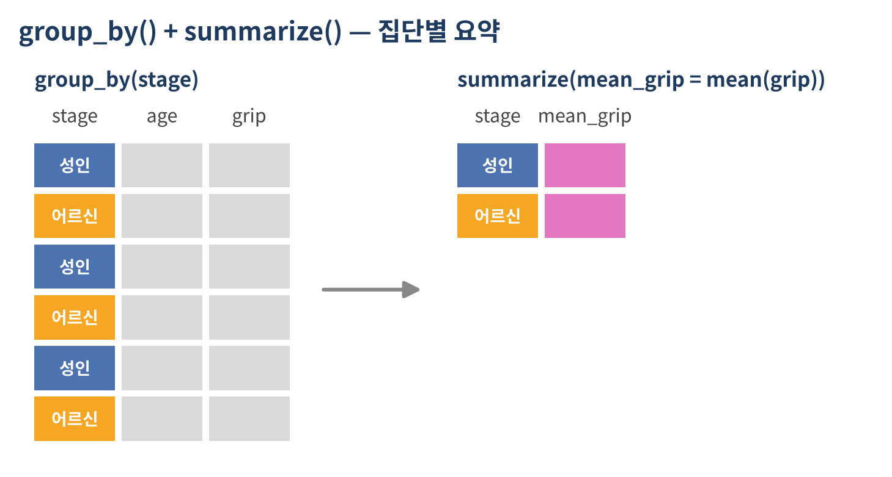
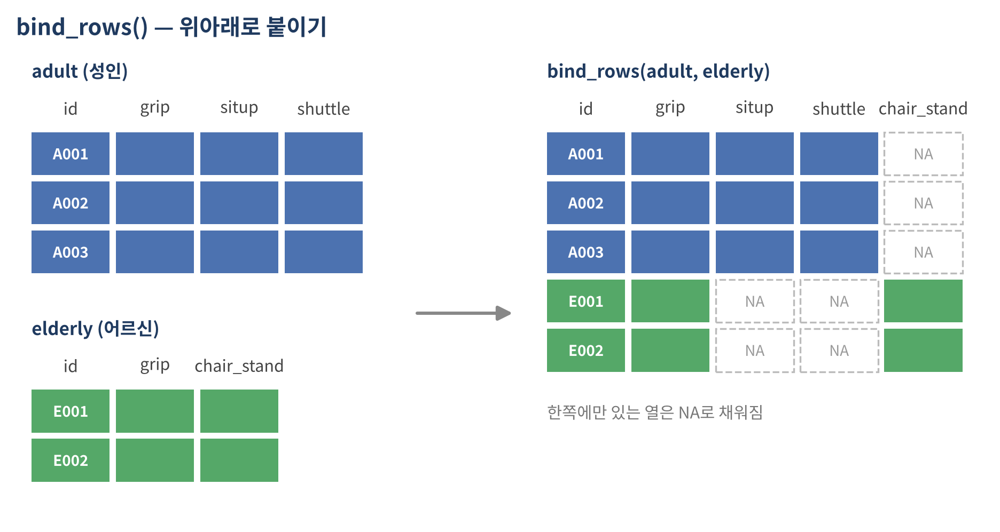
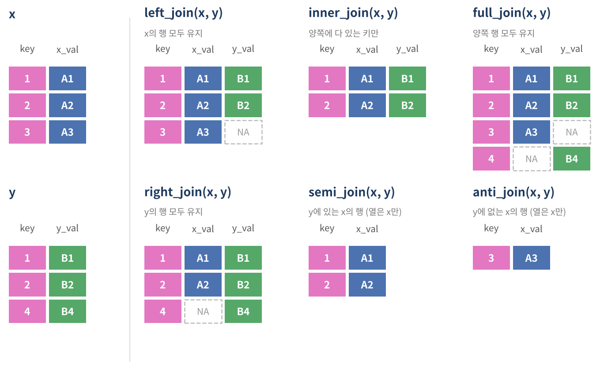

```{r}
#| include: false
source("_common.R")
```

::: {.doc}
::: {.session-meta}
<span>내용: group_by · summarize, count, 집단 안에서 mutate · filter, bind_rows, left · inner · full · anti · semi join, 종합 실습, 부록(연령 단계 비교)</span>
<span>[슬라이드로 보기](d1-04-dataframe-3-slides.html)</span>
:::
:::

## 준비

```{r}
library(dplyr)
source("data/practice_data.R")

# 2교시 결측 코드 정리
fit <- fitness
fit$age[fit$age %in% c(-9, 999)]   <- NA
fit$grip[fit$grip %in% c(-1, 999)] <- NA
fit$shuttle[fit$shuttle == -1]     <- NA
fit$sex[fit$sex == "미상"]         <- NA
fit$exercise[fit$exercise == ""]   <- NA
fit$grade[fit$grade == "측정중단"] <- NA

# 3·4교시 파생변수
fit <- as_tibble(fit) %>%
  mutate(
    bmi      = round(weight / (height / 100)^2, 1),
    grip_rel = round(grip / weight * 100, 1)
  )
programs <- as_tibble(programs)
```

## 오늘 쓰는 데이터

| 데이터 | 한 행의 단위 | 연결 열(키) |
|---|---|---|
| `fit` | 체력측정 1건 (30행, 성인 22 + 어르신 8) | `id` |
| `programs` | 운동처방 프로그램 참여 1건 (15행) | `prog_id`, `id` |

```{r}
#| output-location: fragment
programs
```

# 집단별 요약 {background-color="#1f3a5f"}

`group_by()` + `summarize()`

## `summarize()` — 여러 행을 한 행으로

```{r}
#| output-location: fragment
fit %>%
  summarize(
    n         = n(),
    mean_grip = mean(grip, na.rm = TRUE),
    sd_grip   = sd(grip, na.rm = TRUE),
    max_flex  = max(sit_reach)
  )
```

::: {.doc}
`summarize()`(또는 `summarise()`)는 데이터 전체를 요약해서 한 행짜리 표를 만듦. `이름 = 요약 함수` 형태로 여러 개를 동시에 쓸 수 있음. `n()`은 행 개수를 세는 함수로 `summarize()`, `mutate()`, `filter()` 안에서만 쓸 수 있음. 악력에는 결측(`NA`)이 있으므로 `na.rm = TRUE`가 필요함.
:::

## `group_by()` + `summarize()`

{.diagram}

```{r}
#| output-location: fragment
fit %>%
  group_by(stage) %>%
  summarize(n = n(), mean_grip = mean(grip, na.rm = TRUE))
```

::: {.doc}
`group_by()`는 데이터를 집단으로 나눠 두기만 하고 실제 계산은 하지 않음. 그 뒤의 `summarize()`가 집단마다 따로 계산해서 집단당 한 행으로 줄임. 오전에 `mean(fit$grip[fit$sex == "F"], na.rm = TRUE)`처럼 집단마다 반복하던 계산을 한 번에 처리함.
:::

## 요약 함수 모음

```{r}
fit %>%
  group_by(stage) %>%
  summarize(
    n          = n(),                                  # 인원
    mean_age   = mean(age, na.rm = TRUE),              # 평균
    med_grip   = median(grip, na.rm = TRUE),           # 중앙값
    q90_flex   = quantile(sit_reach, 0.9),             # 90분위수
    top_n      = sum(grade %in% c("1등급", "2등급")),  # 1·2등급 인원
    top_rate   = mean(grade %in% c("1등급", "2등급")), # 1·2등급 비율
    obese_rate = mean(bmi >= 25),                      # BMI 25 이상 비율
    n_center   = n_distinct(center)                    # 측정 센터 수
  )
```

::: {.doc}
1교시에서 다룬 "조건식 + `sum()` = 개수, 조건식 + `mean()` = 비율"이 여기서 자주 쓰임. `n_distinct()`는 중복을 뺀 값의 개수임. `%in%`은 `NA`를 FALSE로 처리하므로 등급이 결측인 사람은 1·2등급이 아닌 것으로 계산됨.
:::

## 두 개 이상의 집단 변수

```{r}
#| output-location: column-fragment
fit %>%
  group_by(stage, sex) %>%
  summarize(n = n(),
            mean_grip = mean(grip, na.rm = TRUE),
            .groups = "drop")
```

::: {.fragment}
- 집단 변수의 **조합**마다 한 행
- `sex`가 `NA`인 사람은 별도 집단(`NA`)으로 나옴
- `.groups = "drop"` : 요약 후 그룹 해제
:::

::: {.doc}
`.groups`를 쓰지 않으면 마지막 집단 변수(`sex`)만 풀리고 `stage`로는 여전히 묶인 상태로 남으며, "`summarise()` has grouped output by 'stage'"라는 안내 메시지가 나옴. 이후 작업에서 예상치 못한 결과가 나올 수 있으므로 `.groups = "drop"`을 붙이거나 `ungroup()`으로 풀어 주는 것이 안전함. 체력 기준은 연령 단계·성별로 다르기 때문에, 체력측정 자료에서는 이렇게 두 변수로 묶어 요약하는 경우가 많음.
:::

## `.by` — 한 번만 묶을 때

```{r}
#| output-location: column-fragment
fit %>%
  summarize(n = n(),
            mean_flex = mean(sit_reach),
            .by = c(stage, center))
```

::: {.doc}
dplyr 1.1.0부터는 `group_by()` 없이 `summarize(..., .by = 열)`로 그 자리에서만 묶을 수 있음. 결과는 항상 그룹이 풀린 상태로 나오므로 `.groups`를 신경 쓰지 않아도 됨. 단, 결과가 집단 순서대로 정렬되지 않고 데이터에 처음 나온 순서대로 나옴.
:::

## 여러 열을 한 번에 요약 — `across()`

```{r}
fit %>%
  group_by(stage) %>%
  summarize(across(c(grip, sit_reach, fat_pct), ~ mean(.x, na.rm = TRUE)))
```

::: {.fragment}
```{r}
fit %>%
  group_by(stage) %>%
  summarize(across(c(grip, sit_reach),
                   list(평균 = ~ mean(.x, na.rm = TRUE), 표준편차 = ~ sd(.x, na.rm = TRUE))))
```
:::

::: {.doc}
`~ mean(.x, na.rm = TRUE)`는 "각 열(`.x`)의 평균을 결측을 빼고 구하라"는 짧은 함수임. `list(평균 = ..., 표준편차 = ...)`처럼 함수 여러 개를 이름과 함께 주면 `열이름_함수이름` 형태의 열이 만들어짐. 측정 항목별 평균·표준편차 표를 만들 때 유용함.
:::

## `count()` — 빈도표

```{r}
#| output-location: column-fragment
fit %>% count(grade)
fit %>% count(center, sort = TRUE)
fit %>% count(stage, exercise)
```

::: {.doc}
`count(grade)`는 `group_by(grade) %>% summarize(n = n())`의 줄임 표현임. `sort = TRUE`면 빈도가 높은 순으로 정렬됨. 여러 열을 주면 조합별 빈도를 셈. 결측도 `NA`라는 값으로 함께 세어 줌.
:::

## 빈도에 비율 붙이기

```{r}
#| output-location: column-fragment
fit %>%
  count(grade) %>%
  mutate(pct = round(n / sum(n) * 100, 1))

fit %>%
  count(stage, exercise) %>%
  group_by(stage) %>%
  mutate(pct = round(n / sum(n) * 100, 1)) %>%
  ungroup()
```

::: {.doc}
두 번째 코드는 연령 단계 안에서의 운동 빈도 구성비(행 비율)를 구함. `group_by(stage)` 후 `mutate()`를 쓰면 `sum(n)`이 연령 단계마다 따로 계산되기 때문임. 이처럼 `group_by()` 뒤에 `mutate()`를 쓰면 행 수는 그대로 두고 집단별 계산 결과를 각 행에 붙임.
:::

## 집단 안에서 `mutate()`

```{r}
#| code-line-numbers: "|2|4|5|6"
fit %>%
  group_by(stage, sex) %>%
  mutate(
    grp_mean = mean(grip, na.rm = TRUE),   # 같은 연령 단계·성별 평균 악력
    diff     = grip - grp_mean,            # 평균과의 차이
    rank_grp = min_rank(desc(grip))        # 같은 집단 안 순위
  ) %>%
  ungroup() %>%
  select(id, stage, sex, grip, grp_mean, diff, rank_grp) %>%
  arrange(stage, sex, rank_grp)
```

::: {.doc}
| | `group_by()` + `summarize()` | `group_by()` + `mutate()` |
|---|---|---|
| 결과 행 수 | 집단 수만큼 줄어듦 | 원래 행 수 그대로 |
| 용도 | 요약표 | 집단 평균과의 차이, 집단 내 순위·비율 |

체력 수준은 같은 연령 단계·성별과 비교해서 판단하는 경우가 많음. `min_rank(desc(grip))`는 악력이 높은 순서로 1, 2, 3 … 순위를 매김(동점이면 같은 순위, `NA`는 순위 없음).
:::

## 집단 안에서 `filter()` · `slice_max()`

::: {.panel-tabset}
### 단계별 악력 최고

```{r}
fit %>%
  group_by(stage) %>%
  slice_max(grip, n = 1) %>%
  ungroup() %>%
  select(id, stage, sex, grip)
```

### 센터 평균보다 유연한 사람

```{r}
fit %>%
  group_by(center) %>%
  filter(sit_reach > mean(sit_reach)) %>%
  ungroup() %>%
  select(id, center, sit_reach)
```

### 8명 이상 측정한 센터만

```{r}
fit %>%
  group_by(center) %>%
  filter(n() >= 8) %>%
  ungroup() %>%
  count(center)
```
:::

## `ungroup()`을 잊으면

```{r}
#| output-location: column-fragment
grouped <- fit %>% group_by(stage)
grouped

grouped %>% summarize(mean_flex = mean(sit_reach))
grouped %>% ungroup() %>%
  summarize(mean_flex = mean(sit_reach))
```

::: {.fragment}
::: {.callout-warning title="주의"}
그룹이 걸린 데이터는 출력 첫 줄에 `# Groups: stage [2]`가 표시됨. 그룹이 남아 있으면 이후 `summarize()`, `mutate()`, `slice()`가 모두 집단별로 계산됨
:::
:::

## 보고용 요약표 만들기

```{r}
fit %>%
  group_by(stage) %>%
  summarize(
    인원          = n(),
    평균BMI       = round(mean(bmi), 1),
    평균상대악력  = round(mean(grip_rel, na.rm = TRUE), 1),
    평균유연성    = round(mean(sit_reach), 1),
    `1·2등급비율` = round(mean(grade %in% c("1등급", "2등급")) * 100, 1)
  ) %>%
  rename(연령단계 = stage)
```

::: {.doc}
보고서에 붙일 표는 마지막 단계에서 반올림하고 열 이름을 한글로 바꿈. 숫자나 특수문자(`·`)로 시작하는 이름은 `` `1·2등급비율` ``처럼 백틱으로 감싸야 함. 분석 중간에는 영문 열 이름을 유지하는 것이 코드 작성에 편함. 둘째 날 시각화에서 이런 요약표를 그래프로 그리게 됨.
:::

## 실습 C · 집단별 요약 {.exercise}

<div class="timer" data-min="12"></div>

`fit` 데이터 사용

1. 등급(`grade`)별 인원, 평균 나이, 평균 상대악력(`grip_rel`)
2. 센터(`center`)별 인원과 평균 앉아윗몸앞으로굽히기(`sit_reach`)를 구하고 평균이 높은 순으로 정렬
3. 연령 단계 · 등급별 인원과, 연령 단계 안에서의 등급 구성비(%)
4. 연령 단계별로 체지방률(`fat_pct`)이 가장 낮은 2명의 `id`, `stage`, `fat_pct`
5. 각 측정자의 체지방률이 같은 연령 단계 · 성별 평균보다 얼마나 높은지(낮은지) 계산한 열 `fat_diff` 만들기

::: {.answer title="실습 C 정답"}
```{r}
fit %>% group_by(grade) %>%
  summarize(n = n(), mean_age = mean(age, na.rm = TRUE),
            mean_grip_rel = mean(grip_rel, na.rm = TRUE))

fit %>% group_by(center) %>%
  summarize(n = n(), mean_flex = mean(sit_reach)) %>% arrange(desc(mean_flex))

fit %>% count(stage, grade) %>% group_by(stage) %>%
  mutate(pct = round(n / sum(n) * 100, 1)) %>% ungroup()

fit %>% group_by(stage) %>% slice_min(fat_pct, n = 2) %>%
  select(id, stage, fat_pct) %>% ungroup()

fit %>% group_by(stage, sex) %>%
  mutate(fat_diff = fat_pct - mean(fat_pct)) %>% ungroup()
```
:::

# 데이터 결합 {background-color="#1f3a5f"}

`bind_rows()` · `_join()`

## 표가 나뉘어 있는 이유와 키

```{mermaid}
%%| echo: false
%%| fig-width: 12
flowchart LR
  F["fit<br/>체력측정 30건<br/>한 행 = 측정자 1명"] -- id --- P["programs<br/>운동처방 참여 15건<br/>한 행 = 참여 1건"]
```

::: {.fragment}
- 측정 결과와 프로그램 참여 기록은 **한 행의 단위가 다름** (한 사람이 프로그램에 여러 번 참여 가능)
- 그래서 **단위별로 표를 나누고, 키(key) 열로 연결**
- 분석할 때 필요한 표끼리 다시 합침 → **결합(join)**
:::

::: {.doc}
참여 기록을 측정 결과 표에 그대로 넣으면, 프로그램에 두 번 참여한 사람은 측정 결과가 두 번 반복되어 저장됨. 이런 중복을 피하려고 단위별로 표를 나누고, 두 표를 연결하는 열(키)을 둠. 여기서는 측정 번호 `id`가 키임.
:::

## 위아래로 붙이기 — `bind_rows()`

{.diagram-lg}

## 연령 단계별 파일을 붙이는 상황

```{r}
#| code-line-numbers: "|1-3|4-6|8"
adult <- fit %>%
  filter(stage == "성인") %>%
  select(-chair_stand, -walk_2min)       # 성인 측정 항목만
elderly <- fit %>%
  filter(stage == "어르신") %>%
  select(-situp, -shuttle)               # 어르신 측정 항목만

all_fit <- bind_rows(adult, elderly)
c(nrow(adult), nrow(elderly), nrow(all_fit))
all_fit %>% slice(21:24) %>% select(id, stage, grip, situp, shuttle, chair_stand)
```

::: {.doc}
실제 자료는 연령 단계별로 측정 항목이 달라 파일이 따로 제공되는 경우가 많음. 여기서는 `fit`을 성인·어르신 파일로 나눈 뒤 다시 붙여서 그 상황을 재현함. `bind_rows()`는 열 이름을 기준으로 행을 이어 붙이고, 한쪽에만 있는 열은 다른 쪽 행에서 `NA`로 채움. 이때의 `NA`는 측정 거부가 아니라 "해당 연령 단계 측정 항목이 아님"이라는 뜻임.
:::

## 출처 표시 — `.id`

```{r}
#| output-location: column-fragment
all_fit <- bind_rows(성인파일 = adult, 어르신파일 = elderly,
                     .id = "file")
all_fit %>% count(file)
```

::: {.doc}
::: {.callout-note title="참고"}
`bind_cols()`는 두 표를 옆으로 붙이는데, 행 순서가 정확히 같다고 가정하고 그대로 붙임. 순서가 다르면 엉뚱한 사람의 값이 붙어도 오류가 나지 않으므로, 옆으로 붙일 때는 키를 기준으로 하는 `_join()`을 쓰는 것이 안전함.
:::
:::

## 옆으로 붙이기 — `_join()` 종류

{.diagram-lg}

::: {.doc}
| 함수 | 남는 행 | 열 |
|---|---|---|
| `left_join(x, y)` | x의 모든 행 | x + y |
| `inner_join(x, y)` | 키가 양쪽에 모두 있는 행 | x + y |
| `full_join(x, y)` | 양쪽의 모든 행 | x + y |
| `right_join(x, y)` | y의 모든 행 | x + y |
| `semi_join(x, y)` | y에 키가 있는 x의 행 | x만 |
| `anti_join(x, y)` | y에 키가 없는 x의 행 | x만 |

짝이 없는 쪽의 열은 `NA`로 채워짐. 실무에서는 기준 표를 그대로 두고 정보를 덧붙이는 `left_join()`을 가장 많이 씀.
:::

## `left_join()` — 참여 기록에 측정 결과 붙이기

```{r}
#| code-line-numbers: "|2"
prog_fit <- programs %>%
  left_join(fit, by = "id")

prog_fit %>% select(prog_id, id, program, sessions, stage, sex, age, grade)
```

::: {.fragment}
- `by` : 두 표를 연결하는 키 열
- 참여 기록 여러 건 ↔ 측정자 1명 (다:1) → 결과 행 수는 참여 기록 수(15) 그대로
- 측정 명부에 없는 `A31`, `E12` → 붙일 정보가 없어서 `NA`
:::

## 결합 후 바로 요약

```{r}
#| output-location: column-fragment
prog_fit %>%
  group_by(stage) %>%
  summarize(n = n(),
            mean_sessions = mean(sessions),
            complete_rate = mean(completed))
```

::: {.doc}
`programs`에는 연령 단계 정보가 없고 `fit`에는 참여 정보가 없음. 두 표를 결합해야 연령 단계별 참여 현황을 요약할 수 있음. `stage`가 `NA`인 집단은 측정 명부와 연결되지 않은 2건임. 결합 → 집단별 요약이 실무 분석에서 가장 흔한 흐름임.
:::

## `inner_join()` vs `left_join()`

```{r}
#| output-location: column-fragment
programs %>%
  left_join(fit, by = "id") %>%
  nrow()

programs %>%
  inner_join(fit, by = "id") %>%
  nrow()
```

::: {.fragment}
- `left_join()` : 참여 기록 15건 모두 유지, 짝 없는 2건은 `NA`
- `inner_join()` : 짝이 있는 13건만 남음 → **조용히 행이 사라질 수 있음**
:::

::: {.doc}
::: {.callout-important title="확인"}
결합 전후로 `nrow()`를 확인하는 습관을 들여야 함. `inner_join()`은 짝이 없는 행을 아무 경고 없이 버리기 때문에, 분석 대상이 줄어든 것을 모르고 지나치기 쉬움.
:::
:::

## 점검용 — `anti_join()` · `semi_join()`

::: {.panel-tabset}
### 명부에 없는 참여 기록

```{r}
programs %>% anti_join(fit, by = "id")
```

### 프로그램에 참여한 측정자

```{r}
fit %>% semi_join(programs, by = "id") %>% select(id, stage, sex, grade)
```

### 참여하지 않은 측정자 수

```{r}
fit %>% anti_join(programs, by = "id") %>% nrow()
```
:::

::: {.doc}
`anti_join()`은 데이터 점검에 매우 유용함. "참여 기록 중 측정 명부와 연결되지 않는 건"처럼 두 표 사이의 불일치를 찾을 때 씀. `semi_join()`은 상대 표의 열을 붙이지 않고 행만 거른다는 점에서 `filter(id %in% programs$id)`와 같음.
:::

## 키가 중복되면 행이 늘어남

```{r}
#| output-location: column-fragment
programs %>% count(id) %>% filter(n >= 2)

fit_prog <- fit %>%
  left_join(programs, by = "id")
nrow(fit)
nrow(fit_prog)
```

::: {.fragment}
- 측정자 1명 ↔ 참여 기록 여러 건 (1:다)
- 2번 참여한 3명은 결과에 **2행씩** 나타남 → 30행이 33행으로
:::

::: {.doc}
::: {.callout-warning title="주의"}
결합 결과의 행 수가 늘었다면 키가 중복된 것임. 의도한 것(측정자별 참여 내역)이면 문제없지만, 측정자 수를 세려고 했다면 `n()` 대신 `n_distinct(id)`를 써야 함. 양쪽 표 모두 키가 중복되면(다:다) 행이 크게 불어나며, dplyr가 경고 메시지를 보여줌.
:::
:::

## 키 이름이 다를 때 · 같은 열 이름이 있을 때

::: {.panel-tabset}
### 키 이름이 다름

```{r}
p2 <- programs %>% rename(member_id = id)

p2 %>%
  left_join(fit, by = join_by(member_id == id)) %>%
  select(prog_id, member_id, stage, age)
```

### 같은 이름의 열

```{r}
p3 <- programs %>% mutate(center = "가람")   # 프로그램 운영 센터라고 가정

p3 %>%
  left_join(fit, by = "id") %>%
  select(prog_id, id, starts_with("center"))

p3 %>%
  left_join(fit, by = "id", suffix = c("_prog", "_test")) %>%
  select(prog_id, id, starts_with("center"))
```
:::

::: {.doc}
키 열 이름이 서로 다르면 `join_by(왼쪽 키 == 오른쪽 키)` 또는 `by = c("member_id" = "id")`로 지정함. 키가 아닌데 이름이 같은 열이 양쪽에 있으면 `.x`, `.y`가 붙어서 구분되며, `suffix`로 붙는 이름을 바꿀 수 있음. `by`를 생략하면 이름이 같은 모든 열을 키로 사용하고 메시지로 알려 주는데, 의도와 다를 수 있으므로 항상 `by`를 직접 쓰는 것이 안전함.
:::

# 종합 실습 {background-color="#1f3a5f"}

연령 단계별 운동처방 참여 현황표 만들기

## 연령 단계별 참여 현황

```{r}
#| code-line-numbers: "|2|3|4-9|10"
prog_by_stage <- programs %>%
  inner_join(fit, by = "id") %>%
  group_by(stage) %>%
  summarize(
    참여건수     = n(),
    참여자수     = n_distinct(id),
    평균참여횟수 = round(mean(sessions), 1),
    수료율       = round(mean(completed) * 100, 1)
  ) %>%
  arrange(desc(참여건수))
prog_by_stage
```

## 측정 인원 대비 참여율

```{r}
#| code-line-numbers: "|1|3-6"
fit_by_stage <- fit %>% count(stage, name = "측정인원")

fit_by_stage %>%
  left_join(prog_by_stage, by = "stage") %>%
  mutate(참여율 = round(참여자수 / 측정인원 * 100, 1)) %>%
  arrange(desc(참여율))
```

::: {.doc}
요약표끼리도 결합할 수 있음. 분모(연령 단계별 측정 인원)와 분자(연령 단계별 참여자 수)를 각각 요약한 뒤 `stage`를 키로 결합하면 비율 지표를 만들 수 있음. 가상 데이터이므로 수치 자체에는 의미가 없음.
:::

## 프로그램 · 등급 · 센터별로 보기

::: {.panel-tabset}
### 프로그램 × 연령 단계

```{r}
programs %>%
  inner_join(fit, by = "id") %>%
  count(stage, program)
```

### 등급별 수료율

```{r}
programs %>%
  inner_join(fit, by = "id") %>%
  group_by(grade) %>%
  summarize(n = n(), complete_rate = round(mean(completed), 2), .groups = "drop")
```

### 센터별 참여자 수

```{r}
fit %>%
  semi_join(programs, by = "id") %>%
  count(center, name = "참여자수")
```
:::

## 실습 D · 결합과 요약 {.exercise}

<div class="timer" data-min="15"></div>

1. 프로그램 종류(`program`)별 참여 건수, 평균 참여 횟수, 수료율
2. 측정 명부에 없는 참여 기록의 `prog_id`, `id` 확인하기
3. 센터(`center`)별 측정 인원, 프로그램 참여자 수, 참여율(%)
4. 등급별 평균 참여 횟수를 높은 순으로 정렬
5. 운동 빈도(`exercise`)별로, 프로그램 참여 경험이 있는 측정자의 비율 구하기
   - 힌트: `mutate(joined = id %in% programs$id)`

::: {.answer title="실습 D 정답"}
```{r}
# 1
programs %>% group_by(program) %>%
  summarize(n = n(), mean_sessions = mean(sessions), complete_rate = mean(completed))
# 2
programs %>% anti_join(fit, by = "id") %>% select(prog_id, id)
# 3
f_center <- fit %>% count(center, name = "측정인원")
p_center <- programs %>% inner_join(fit, by = "id") %>%
  group_by(center) %>% summarize(참여자수 = n_distinct(id))
f_center %>% left_join(p_center, by = "center") %>%
  mutate(참여율 = round(참여자수 / 측정인원 * 100, 1))
# 4
programs %>% inner_join(fit, by = "id") %>% group_by(grade) %>%
  summarize(mean_sessions = mean(sessions)) %>% arrange(desc(mean_sessions))
# 5
fit %>%
  mutate(joined = id %in% programs$id) %>%
  group_by(exercise) %>%
  summarize(n = n(), joined_rate = round(mean(joined), 2))
```
:::

# 부록 · 연령 단계 비교 {background-color="#1f3a5f"}

시간이 남으면 진행

## 성인과 어르신 함께 보기

```{r}
fit %>%
  filter(!is.na(age), !is.na(sex)) %>%
  mutate(age10 = paste0(age %/% 10 * 10, "대")) %>%
  group_by(stage, age10, sex) %>%
  summarize(n = n(),
            mean_grip_rel = round(mean(grip_rel, na.rm = TRUE), 1),
            mean_flex     = round(mean(sit_reach), 1),
            .groups = "drop")
```

::: {.doc}
`age %/% 10 * 10`은 나이를 10으로 나눈 몫에 10을 곱해 10세 단위 연령대(20, 30, … 70)를 만드는 식임. 상대악력과 앉아윗몸앞으로굽히기는 두 연령 단계에 공통으로 있는 항목이어서 나이에 따른 변화를 이어서 볼 수 있음. 연령 단계별 고유 항목(교차윗몸일으키기, 의자에앉았다일어서기 등)은 해당 단계 안에서만 비교함. 표본이 30명이라 집단별 인원이 매우 적다는 점에 유의.
:::

## 부록 실습 {.exercise}

<div class="timer" data-min="15"></div>

`fit` 데이터 사용

1. 두 연령 단계에 공통으로 있는 측정 항목만 남기기 (`id`, `stage`, `sex`, `age`, `grip`, `sit_reach`, `fat_pct`, `grade`)
2. 연령 단계 · 성별 평균 상대악력과 평균 체지방률
3. 센터별 어르신 측정 비율(%)을 구하고 비율이 높은 순으로 정렬
4. 연령 단계별 등급 구성비(%)
5. 어르신 중 의자에앉았다일어서기(`chair_stand`)가 같은 성별 평균보다 높은 사람의 비율

::: {.answer title="부록 실습 정답"}
```{r}
# 1
fit %>% select(id, stage, sex, age, grip, sit_reach, fat_pct, grade)
# 2
fit %>% group_by(stage, sex) %>%
  summarize(mean_grip_rel = round(mean(grip_rel, na.rm = TRUE), 1),
            mean_fat      = round(mean(fat_pct), 1), .groups = "drop")
# 3
fit %>% group_by(center) %>%
  summarize(n = n(), elderly_pct = round(mean(stage == "어르신") * 100, 1)) %>%
  arrange(desc(elderly_pct))
# 4
fit %>% count(stage, grade) %>% group_by(stage) %>%
  mutate(pct = round(n / sum(n) * 100, 1)) %>% ungroup()
# 5
fit %>% filter(stage == "어르신") %>%
  group_by(sex) %>%
  mutate(above = chair_stand > mean(chair_stand)) %>%
  summarize(above_rate = round(mean(above), 2))
```
:::

## 오늘 배운 것

| 시간 | 내용 | 주요 함수 |
|---|---|---|
| 1교시 | 자료형 · 자료구조 | `class()`, `c()`, `factor()`, `list()`, `data.frame()` |
| 2교시 | 데이터프레임 기본 조작 | `str()`, `summary()`, 결측 코드 정리, `df[행, 열]`, `order()` |
| 3·4교시 | dplyr 동사 | `%>%`, `select()`, `filter()`, `mutate()`, `case_when()`, `arrange()` |
| 5·6교시 | 요약과 결합 | `group_by()`, `summarize()`, `count()`, `bind_rows()`, `left_join()`, `anti_join()` |

::: {.fragment}
::: {.box}
**둘째 날**: 오늘 만든 요약표를 그래프로 그리고(시각화), 변수 간 관계를 회귀분석으로 설명 · 예측함. 실제 국민체력100 데이터 분석에서 오늘 배운 전처리 · 요약 · 결합을 그대로 사용함.
:::
:::
